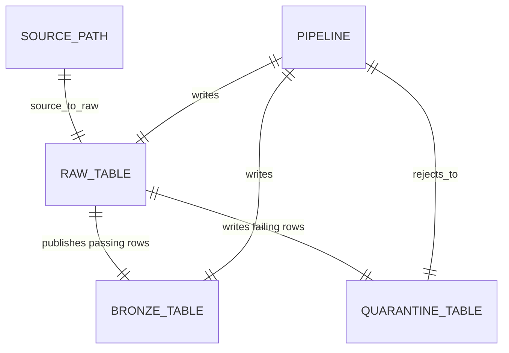
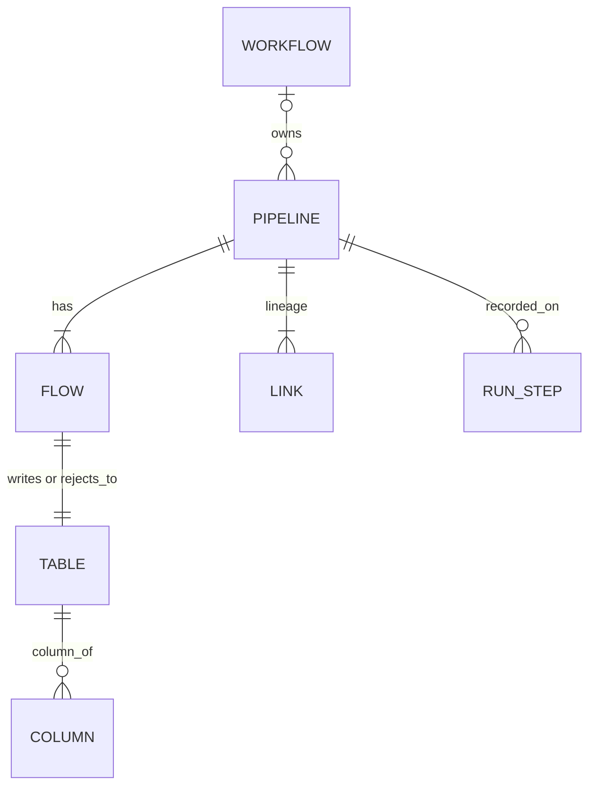

# Lakeflow framework

Standalone, config-driven file ingestion for Databricks Lakeflow. An Allianz team adopts it by pinning the wheel, adding one bronze YAML file, and adding a one-line pipeline. Many domains and projects share that wheel and one registry. `databricks bundle deploy` builds the wheel and uploads it.

This version loads files into raw, then publishes raw to bronze. Rows that fail quality rules go to quarantine. Silver and gold use the same `<system>_<layer>` schema name later. They are not built here.

## End to end

One pipeline owns three Unity Catalog tables. Files land in raw. A row that passes the rules is published to bronze. A row that fails is written to quarantine.



The same YAML is recorded in `<catalog>.framework_meta`. Two physical tables hold every object and every run. The boxes below are kinds of row, not extra tables. `WORKFLOW` is stored when the YAML sets `job_name`. Each pipeline has one flow, one table, and one link for raw, for bronze, and for quarantine.



`TABLE` is a `streaming_table`, a `table`, or a `materialized_view`. `COLUMN` hangs off the raw, bronze, and quarantine table names. `RUN_STEP` is a row in `run_ledger`. Every other box is a row in `object_registry`. A new row is inserted when that object's own hash changes. `v_object_history` turns those rows into `valid_from` and `valid_to`. The physical columns and the views are in [framework_docs/ARCHITECTURE.md](framework_docs/ARCHITECTURE.md).

## Layout

| Path | Role |
| --- | --- |
| `framework_src` | The wheel. Public names are `build_pipeline`, `validate_configs`, and `LoadMethod`. |
| `framework_sql` | Registry DDL for `framework_meta`. |
| `framework_bundle` | Bundle that builds the wheel and runs DDL, the collector, and daily `OPTIMIZE`. |
| `framework_examples/consumer` | A second bundle: bronze YAML, pipeline files, and jobs. |
| `framework_tests` | Package tests. They do not start Spark. |
| `framework_docs` | Consumer guide, maintainer notes, and the end-to-end path. |

## Add a pipeline

```python
from lakeflow_framework import build_pipeline

build_pipeline("billing_invoices")
```

`build_pipeline` reads the current row from `<catalog>.framework_meta.v_object_current`. The id must match `pipeline_id` in the YAML.

```yaml
pipeline_id: billing_invoices
domain: finance
project: billing
data_domain: invoices
team: billing_squad
technical_owner: billing.owner@jll.com
layer: bronze
catalog: framework_dev

notify:
  on_failure:
    - billing.owner@jll.com
  on_success:
    - billing.owner@jll.com

data:
  classification: confidential
  pii:
    - pii_finance
    - pii_personal

source_to_raw:
  method: autoloader
  source:
    system: billing
    format: csv
    path: abfss://landing@storage.dfs.core.windows.net/billing/invoices/
    delimiter: ","
  raw:
    schema: billing_raw
    table: invoices

raw_to_bronze:
  bronze:
    schema: billing_bronze
    table: invoices
  dedup: true
  primary_keys: [invoice_id]
  watermark_column: updated_at
  rules:
    - name: amount_non_negative
      expression: amount >= 0

quarantine:
  schema: billing_quarantine
  table: invoices
```

`source_to_raw.method` is `autoloader` (default), `copy_into`, or `ctas`. Paths are `abfss://` or `s3://`. `dedup: true` requires `primary_keys` and `watermark_column`. Excel cannot use `copy_into`. Do not put keys or passwords in the file. Render `catalog` before validation. An unresolved `${...}` is an error.

One domain holds many projects. Each pipeline names its `domain`, `project`, `data_domain`, `team`, and `technical_owner`. `data.classification` is `internal`, `confidential`, or `highly_confidential`. `data.pii` is any of `pii_health`, `pii_basic`, `pii_finance`, `pii_biometric`, and `pii_personal`. Leave `pii` out when the table has none. A raw, bronze, or quarantine block can override those two fields. `notify.on_failure` is who Databricks mails when the job fails. Omit it and the technical owner is used. `notify.on_success` is optional. Put the same addresses on the job `email_notifications` block.

`raw_to_bronze.columns` is the column contract for raw, bronze, and quarantine. Each entry has `name`, `type`, and an optional `description`. `classification` and `pii` on a column override the bronze table. Leave them off and the column keeps the table tags. Raw also records `_source_file` and `_ingested_at`. Quarantine also records `failed_rules`.

Check the file before a cluster starts:

```bash
lakeflow-framework validate configs/bronze
```

The command prints every error in one pass.

## Deploy

The bundle is the build. Both `framework_bundle` and `framework_examples/consumer` declare a wheel artifact on `framework_src`. Deploy builds `framework_src/dist/*.whl` and uploads it. Jobs and pipelines reference that file.

```bash
cd framework_bundle
databricks bundle deploy --target dev
```

Then run the `framework_ddl` job, and start `framework_collector`. The collector is the only writer of the registry tables. Pipeline jobs write small JSON files to `/Volumes/<catalog>/framework_meta/framework_events`.

`framework_examples/consumer` is the shape another team copies: YAML under `configs/bronze`, a one-line file under `pipelines`, and a job that syncs definitions, waits until they are visible, then refreshes the pipelines.

Dev uses development mode and catalog `framework_dev`. Prod uses production mode and catalog `framework_prod`.

## See a run

Query `<catalog>.framework_meta`, with a `project` filter:

| View | What it answers |
| --- | --- |
| `v_object_current` | Current pipeline, flow, and table definitions |
| `v_run_current` | Latest step in the last 7 days |
| `v_process` | Every step of a run |
| `v_recon` | Source and target counts on the success step |
| `v_lineage` | Links from a pipeline to raw, bronze, and quarantine |
| `v_pipelines` | Domain, project, data domain, team, owner, and who is mailed |
| `v_tables` | Classification and PII on each raw, bronze, and quarantine table |
| `v_columns` | Current column type, description, classification, and PII |
| `v_column_history` | Every column version, with `valid_from`, `valid_to`, and `is_current` |
| `v_object_history` | Every version of a pipeline, workflow, flow, table, link, or column |

History is insert-only. A daily job runs `OPTIMIZE`.

To see the system as it was at a moment, filter `v_object_history`. A version was active from `valid_from` until `valid_to`. A null `valid_to` is the version still stored as current. The same filter works for pipelines (`object_kind = 'pipeline'`), workflows (`workflow`), flows (`flow`), tables (`table`, `streaming_table`, or `materialized_view`), and columns (`column`). `v_column_history` is that filter with the column fields already extracted.

```sql
SELECT object_kind, full_name, config_json, valid_from, valid_to
FROM framework_meta.v_object_history
WHERE valid_from <= TIMESTAMP '2026-11-08 00:00:00'
  AND (valid_to IS NULL OR valid_to > TIMESTAMP '2026-11-08 00:00:00')
```

An unchanged table does not get a new row when only the pipeline or job name changes. A return to an older type, tag, or pipeline document does get a new row, so the dates in between stay correct. Filter `project` and `object_kind` in that query. Those are cluster columns, so the read does not scan every project. Join a run to this view on `project`, `object_kind`, and `full_name`, and keep `started_at` inside `valid_from` and `valid_to`.

## Examples

| Config | Into raw | Bronze |
| --- | --- | --- |
| `billing_invoices.yaml` | Auto Loader, CSV | Dedup on `invoice_id` |
| `ledger_entries.yaml` | CTAS, fixed-width | Keys only |
| `orders_events.yaml` | COPY INTO, JSON | Status rule |
| `payroll_timesheets.yaml` | Auto Loader, Excel | Dedup on employee and work date |
| `price_book.yaml` | Auto Loader, Parquet | Positive price rule |

Sample tests for those files are in `framework_examples/consumer/tests/test_bronze_loads.py`. Copy that file beside a new config. It checks table names and load SQL. It does not start a cluster.

## Work in this repo

```bash
./run.sh install
./run.sh test:quick
./run.sh lint
```

`install` puts the package and Ruff into the active environment. `test:quick` runs `framework_tests` and the sample bronze tests. `lint` runs Ruff. The pre-commit config runs Ruff plus YAML, TOML, whitespace, and private-key checks.

## Read next

- [framework_docs/README.md](framework_docs/README.md) for the YAML contract
- [framework_docs/END_TO_END.md](framework_docs/END_TO_END.md) for the collector, quality rules, and registry
- [framework_docs/MAINTAINERS.md](framework_docs/MAINTAINERS.md) for versioning and deploy
- [framework_docs/ARCHITECTURE.md](framework_docs/ARCHITECTURE.md) for the package boundaries
