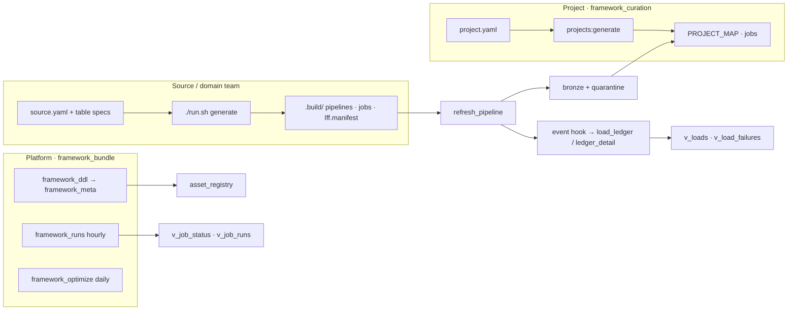
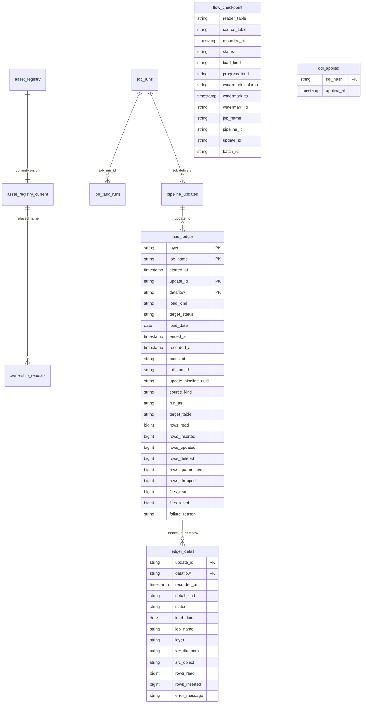
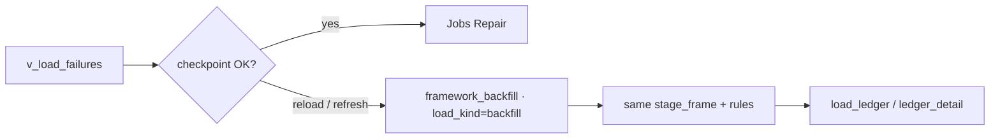

# Lakeflow framework

Config-driven ingestion and a metadata registry for Databricks Lakeflow. Teams add YAML, run one command, and the framework produces the pipelines, jobs, and a map. Source ingestion is shared by a domain. Silver, gold, and data products belong to projects.

## How it fits together



Config → generate (`.build/` + `lff.manifest`) → deploy (DDL / `registry_sync`) → run (`refresh_pipeline` + event-hook ledgers) → hourly `framework_runs` / daily archive. Editable diagrams: [Lucidchart](https://lucid.app/lucidchart/4713f75e-9ce7-407b-a31c-5444a17b9ec9/edit).


| Folder | Role | Owner |
| --- | --- | --- |
| `framework_lff_lib` | The wheel: config validation, pipeline graph, generators, registry rows. Public names are `build_pipeline`, `validate_configs`, and `LoadMethod`. | Platform team |
| `framework_bundle` | The deployed framework: the wheel, frozen `framework_meta` DDL, hourly `framework_runs`, daily `OPTIMIZE` / archive, and the `framework_backfill` job (reload files of any table, or refresh it) | Platform team |
| `framework_ingestion` | Source to bronze. Specs, and the pipelines and jobs generated from them. | Domain, per source system |
| `framework_curation` | One bundle per project for silver, gold, and data products, with ownership checks and maps | One project each |
| `framework_examples/ingestion` | Specs for each ingestion kind: a raw volume, SharePoint, a database, and cloud files | None |
| `framework_examples/consumer` | The original single-bundle example. Reference only. | None |
| `framework_tests` | Package tests. They do not start Spark. | Platform team |
| `framework_docs` | Contract, end-to-end path, architecture, maintainers, roadmap | Platform team |

## What each source kind does

| Kind | Data arrives as | Raw layer | Bronze load |
| --- | --- | --- | --- |
| `sftp_files`, `sharepoint_files` | Many files | A Unity Catalog volume of files as delivered | Auto Loader reads the volume into bronze |
| `database` | Tables in PostgreSQL, Azure SQL, SQL Server, or DB2 | None. A foreign catalog exposes the database | Each table loads into bronze: `snapshot` or `merge` |
| `cloud_files` | Files on ADLS or S3 | A raw table | Auto Loader, COPY INTO, or CTAS, then bronze. Not in the MVP: validation rejects these methods |

Rows that fail a quality rule go to a quarantine table. Getting SFTP and SharePoint files into the raw volume is not built; it is the first phase 1 item ([ROADMAP](framework_docs/ROADMAP.md)).

## Who owns what

- A **source system** belongs to a domain. Its bronze tables are owned by the source system, never by the team that asked for them. The registry records `requested_by` beside the owner.
- A **project** owns its silver, gold, and data-product tables. A table name is owned once; another project reads it as `<project>.silver.<name>` or `<project>.product.<name>`.
- `registry_sync` refuses a definition for a table another owner holds and records a failed `ownership_check` step. `v_ownership_conflicts` stays empty.

## Add a table to a source system

```bash
./run.sh new-source finance erp erp.owner@jll.com database nightly   # new source system only
./run.sh new-table finance erp customers billing                      # the project is last; omit it to put the spec next to source.yaml
# edit sources/erp/billing/erp_customers.yaml and replace every TODO
./run.sh generate
```

`generate` validates every source and spec, then writes committed `SOURCE_MAP.md` and gitignored `.build/` artifacts (pipelines, jobs, delivery manifests). Details are in [framework_ingestion/README.md](framework_ingestion/README.md).

The generated pipeline file is one line (`build_pipelines([...])`), because the datasets are built when the pipeline runs. To read what a table's pipeline builds, run `./run.sh expand <spec.yaml> <catalog>`. It writes `<pipeline_id>_pipeline.py` and `.sql` to `framework_ingestion/.build/expanded/`, for review only (they are not deployed). It handles append tables read from a volume; a table that keeps history by key (Auto CDC) is refused.

## Add a project, silver, gold, or data product

```bash
./run.sh new-project finance billing_reporting reporting.owner@jll.com
# edit framework_curation/finance/billing_reporting/project.yaml
./run.sh projects:generate
```

`projects:generate` checks every reference against the ingestion bundle and the other projects, then writes `PROJECT_MAP.md` and `PROJECTS_INDEX.md`. Details are in [framework_curation/README.md](framework_curation/README.md). The transforms themselves are phase 1.

## Prerequisites before a deploy

- The catalog exists, and you can create objects in it.
- The schemas the specs name exist, for every source system: its raw, bronze, and quarantine schemas.
- For `sftp_files` and `sharepoint_files`, the raw volume exists. The file-arrival trigger needs it when the job is created.
- For `database`, the foreign catalog exists and can read the source tables.
- Something delivers the files into the raw volume.
- You are logged in: `databricks auth login --host <host> --profile <name>`.

## Deploy order

1. `./run.sh bundle:deploy framework_bundle <target> <profile>`. After the upload it runs `framework_ddl`, so the registry tables and views exist when the command returns. It then runs `framework_system_views`, which does nothing unless the target sets `system_views` to `true`; see [cost and observed lineage](framework_docs/END_TO_END.md#cost-and-observed-lineage-optional). Nothing else needs system table grants.
2. `./run.sh bundle:deploy framework_ingestion <target> <profile>`. After the upload it runs `registry_sync`, which writes every deployed spec into the registry and applies the specs' tags and column comments in Unity Catalog. It is the only writer of definitions.
3. `./run.sh bundle:deploy framework_curation/<domain>/<project> <target> <profile>`, once projects have silver and gold resources.

`bundle:validate` and `bundle:deploy` regenerate the maps and resources first, so an invalid spec stops the run before Databricks is contacted. Both bundles use the same catalog per target, because ingestion reads the registry in the platform bundle's catalog. A delivery job refreshes its pipeline, which records its own load metrics: the pipeline reads its delivery from `lff.manifest`, and a run does not write the registry.

## `framework_meta` data model

Editable Lucidchart (source of truth): [framework_meta ERD + taxonomy](https://lucid.app/lucidchart/4713f75e-9ce7-407b-a31c-5444a17b9ec9/edit).  
Pages: [1 · ERD](https://lucid.app/lucidchart/4713f75e-9ce7-407b-a31c-5444a17b9ec9/edit?page=page1#) · [2 · table/view lookup](https://lucid.app/lucidchart/4713f75e-9ce7-407b-a31c-5444a17b9ec9/edit?page=ejCNub9Z7cfa#). Offline catalog: [framework_meta_data_dictionary.html](framework_docs/framework_meta_data_dictionary.html).

**How ops use this:** `v_loads` / `v_load_failures` = did last night’s tables load? `v_ledger_detail` = which file blocked? `v_flow_checkpoint` = how far has this job safely read its source? Raw facts stay in `load_ledger` / `ledger_detail` / `flow_checkpoint` / `job_runs`. After ~90 days, older load and job history moves to `*_archive` (kept for audit). Event logs live in `framework_events`.



## Query views by usage

All live under `<catalog>.framework_meta`. Filter by `owner` where present. Definitions are SCD Type 2 (changed specs close the old version; removed specs get a deletion version). Events (`load_ledger`, `ledger_detail`, `job_runs`) are insert-only. A job can be green while its load is `FAILED` — watch recon, not only job status.

### Load health and repair (recon SoR)

Use these after a delivery run, before trusting bronze. Written by the pipeline event hook (near real time); not the job green light.

| View | Use for |
| --- | --- |
| `v_loads` | Latest outcome per table load — counts, status, error (dashboards / “what failed?”) |
| `v_flow_checkpoint` | How far each incremental job has safely read its source — next run starts here |
| `v_ledger_detail` | Which file or input failed in that load — drill from a failed row in `v_loads` |
| `v_load_failures` | Failed loads joined to job/task reasons — repair work queue |



### Job and pipeline run status

Recorded hourly by `framework_runs` (Jobs API / `system.lakeflow` + event logs). Lag up to ~1h for run status; recon does not wait on this.

| View | Use for |
| --- | --- |
| `v_job_status` | Each workflow’s latest run: `RUNNING` / `SUCCEEDED` / `FAILED` / `SKIPPED`, termination code, run page |
| `v_job_runs` | Append-only job run history (latest per job/run via the view) |
| `v_job_task_runs` | Per-task outcomes (e.g. `refresh_pipeline`) and task `failure_reason` |
| `v_pipeline_updates` | Lakeflow update start/end/state/status + `run_as` |

### Definitions and ownership

Written only by `registry_sync` at deploy. Look up what is supposed to exist and who owns it.

| View | Use for |
| --- | --- |
| `v_asset_registry_current` | Current definition for every object kind, with owner |
| `v_asset_registry_history` | SCD2 time travel: `valid_from` / `valid_to` / `is_current` / `is_deleted` |
| `v_source_systems`, `v_schemas` | Source.yaml declaration and schemas/tags |
| `v_workflows` | Delivery jobs, pipeline ids, requesters |
| `v_pipelines` | Domain, team, technical owner, notify lists |
| `v_dataflows` | Raw path/table, bronze, quarantine per table load |
| `v_flows` | Per-layer flow with relation, path, or table |
| `v_tables` | Owner, requester, classification, PII, load method |
| `v_ownership_conflicts` | Names with more than one owner — should stay empty |
| `v_ownership_refusals` | Deploys refused because another owner holds the name |

### Columns and declared lineage

| View | Use for |
| --- | --- |
| `v_columns`, `v_column_history` | Current and past columns: type, description, tags |
| `v_lineage` | Declared pipeline → table write/reject edges |

### Optional (needs `system_views: true` or UC compare)

| View | Use for |
| --- | --- |
| `v_metadata_drift` | Declared tags/comments vs Unity Catalog `information_schema` |
| `v_job_costs`, `v_pipeline_costs` | DBUs / list cost per run or update (`system.billing`) |
| `v_observed_lineage` | Declared vs UC-observed sources (`system.access.table_lineage`) |

```sql
-- load health for a delivery (recon, not job green)
SELECT dataflow, target_table, load_kind, target_status, rows_read, rows_inserted, failure_reason
FROM aal_dev_fdh.framework_meta.v_loads
WHERE job_name = 'abs_daily'
ORDER BY started_at DESC;

-- latest job status for every billing-owned workflow
SELECT job_name, status, termination_code, run_id, started_at
FROM aal_dev_fdh.framework_meta.v_job_status
WHERE owner = 'billing';

-- what a delivery job is supposed to load
SELECT job_name, pipeline_ids, requesters, delivery
FROM aal_dev_fdh.framework_meta.v_workflows
WHERE owner = 'billing';
```

## Work in this repo

```bash
source venv/bin/activate        # or set PYTHON to a venv's python
./run.sh install                # editable install with the dev tools
./run.sh test:quick             # package tests; no Spark
./run.sh lint                   # pre-commit: Ruff, mypy, hygiene, generate checks
./run.sh check:rules <profile> <warehouse-id> [catalog]   # run every quality rule on a warehouse before deploying
./run.sh backfill <target> <profile> table=<id> mode=files|dates|failed|full_refresh [files=a.csv,b.csv] [date_from=.. date_to=..] [dry_run=false] [confirm=true]
                                # reload files of one table, or refresh it, through its own rules; a dry run unless dry_run=false
./run.sh generate:check         # also a local pre-commit hook when ingestion paths change
./run.sh projects:check         # also a local pre-commit hook when curation/example paths change
./run.sh clean                  # remove wheels, build output, and caches
./run.sh help                   # every task
```

## Read next

- [framework_docs/README.md](framework_docs/README.md) for every YAML contract: `source.yaml`, table specs, `project.yaml` (and [query views by usage](#query-views-by-usage))
- [framework_docs/END_TO_END.md](framework_docs/END_TO_END.md) for the run path, quality rules, and the registry
- [framework_docs/ARCHITECTURE.md](framework_docs/ARCHITECTURE.md) for the flows, the data model of every table the framework writes, the module boundaries, and the design choices
- [framework_docs/META_MODEL_REVIEW.md](framework_docs/META_MODEL_REVIEW.md) for the frozen `framework_meta` schema, who writes what and when, and removed objects
- [framework_docs/MAINTAINERS.md](framework_docs/MAINTAINERS.md) for versioning, deploy, and what not to change
- [framework_docs/ROADMAP.md](framework_docs/ROADMAP.md) for what is built, phase 1, and what is not verified
