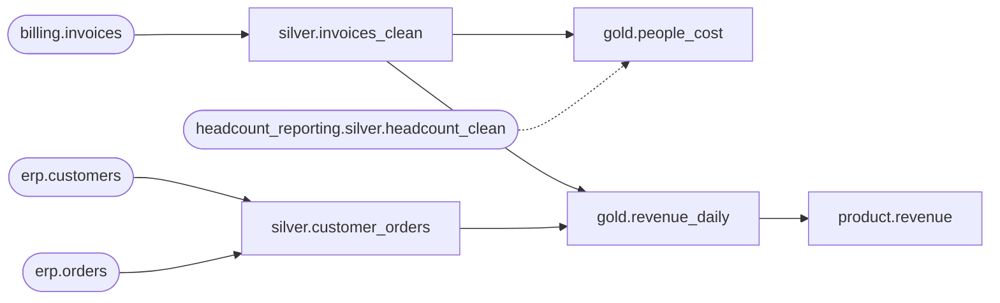

# Project map: finance / billing_reporting

Generated by `lakeflow-framework projects`. Do not edit. Change `project.yaml` and regenerate.

Owner: reporting.owner@jll.com.

## Silver

| Table | Triggered by | Reads | Deadline |
| --- | --- | --- | --- |
| customer_orders | `erp.customers` (bronze, nightly delivery, requested by erp), `erp.orders` (bronze, nightly delivery, requested by billing) | - | 07:00 UTC, alert |
| invoices_clean | `billing.invoices` (bronze, daily delivery, requested by billing) | - | - |

## Gold

| Table | Triggered by | Reads | Deadline |
| --- | --- | --- | --- |
| people_cost | `silver.invoices_clean` | `headcount_reporting.silver.headcount_clean` (project headcount_reporting) | - |
| revenue_daily | `silver.invoices_clean`, `silver.customer_orders` | - | 08:00 UTC, alert |

## Data products

| Table | Triggered by | Reads | Deadline |
| --- | --- | --- | --- |
| revenue | `gold.revenue_daily` | - | 09:00 UTC, alert |

## Checks

- None.

## Used by other projects

- None.

