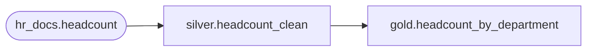

# Project map: people / headcount_reporting

Generated by `lakeflow-framework projects`. Do not edit. Change `project.yaml` and regenerate.

Owner: hr.owner@jll.com.

## Silver

| Table | Triggered by | Reads | Deadline |
| --- | --- | --- | --- |
| headcount_clean | `hr_docs.headcount` (bronze, daily delivery, requested by hr) | - | - |

## Gold

| Table | Triggered by | Reads | Deadline |
| --- | --- | --- | --- |
| headcount_by_department | `silver.headcount_clean` | - | - |

## Checks

- None.

## Used by other projects

- `headcount_reporting.silver.headcount_clean` is used by billing_reporting: gold.people_cost

