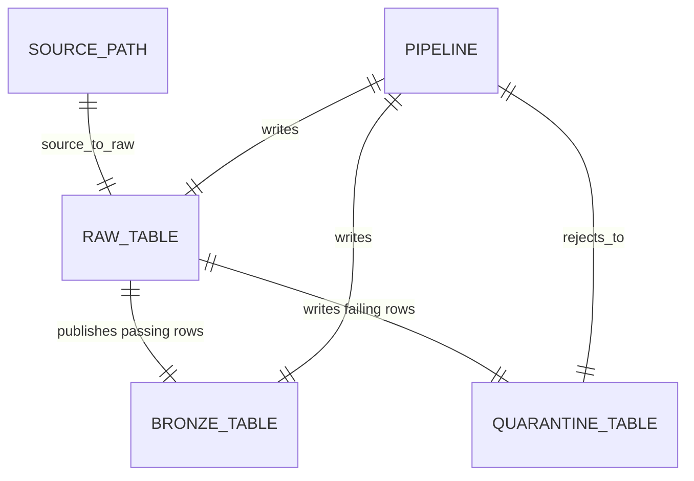
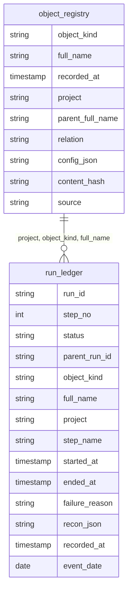
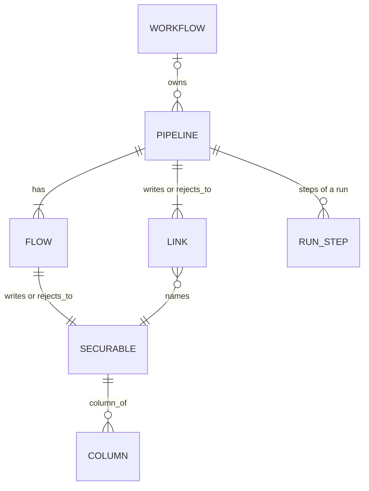
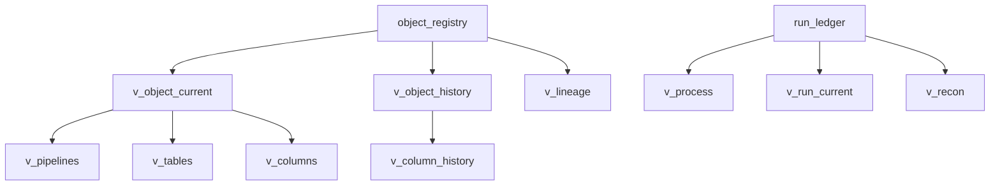
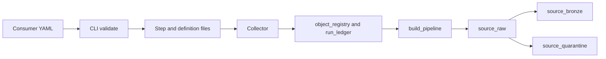

# Architecture

## What this package does

This package is the shared ingestion framework. An Allianz domain adds bronze YAML and a one-line pipeline and uses this load path. Files land in raw, valid rows are published to bronze, and failed rows go to quarantine. The registry is `object_registry` and `run_ledger` in Unity Catalog.

## Data on the way in

`source_to_raw.method` is `autoloader`, `copy_into`, or `ctas`. Raw, bronze, and quarantine are `<catalog>.<system>_<layer>.<table>`. One source row is published to bronze or written to quarantine.

Auto Loader checks the format allow-list, requires a positive `max_files_per_trigger` when one is set, requires a CSV delimiter, allows Excel `header_rows` of 0 or 1, requires an Excel `data_address`, and leaves Excel schema evolution off. The `cloudFiles` options cover format, existing files, type inference, overwrites, rescue on permissive text, header, delimiter, and path glob. File pipelines do not set a checkpoint path or `cloudFiles.schemaLocation`.

## Registry, physical

History is insert-only. A version is `(object_kind, full_name, recorded_at)`. A run step is `(run_id, step_no, status)`. The tables do not declare those as primary keys. A run matches the definition that was active when `project`, `object_kind`, and `full_name` are equal and `started_at` is inside `[valid_from, valid_to)`.

`object_registry` is clustered by `(project, object_kind, full_name, recorded_at)`. `run_ledger` is clustered by `(project, event_date, full_name, run_id)`.

## Registry, logical

Every box is a row in `object_registry`, except `RUN_STEP`, which is a row in `run_ledger`. `parent_full_name` and `relation` are the edges.

| Kind | `full_name` | Parent | `relation` | What `config_json` holds |
| --- | --- | --- | --- | --- |
| `workflow` | `job_name` | none | none | `pipeline_id` |
| `pipeline` | `pipeline_id` | `job_name` when set | `owns` | Canonical YAML and compiled rules |
| `flow` | `<pipeline_id>.raw`, `.bronze`, `.quarantine` | pipeline | `writes` or `rejects_to` | Table name and layer |
| `streaming_table`, `table`, `materialized_view` | `<catalog>.<schema>.<table>` | the flow name | `writes` or `rejects_to` | Layer, owner, classification, PII |
| `link` | `<pipeline_id>-><table>` | pipeline | `writes` or `rejects_to` | Child table name |
| `column` | `<table>.<column>` | table name | `column_of` | Ordinal, type, description, classification, PII |

Raw is a `streaming_table` for Auto Loader and a `table` for COPY INTO and CTAS. Quarantine and bronze are a `materialized_view` for CTAS and a `streaming_table` otherwise. Dedup bronze stays a `streaming_table` because Auto CDC writes it.

A column hash covers ordinal, data type, description, classification, and PII. The column name is the key, so a rename is a different column. A job rename versions the pipeline and the workflow. It does not version a table or column whose own document is unchanged.

## Views

Views do not store a second copy. Current views keep the latest row. History views add `valid_from` (`recorded_at`) and `valid_to` (the next `recorded_at` for that object, or null).

`v_lineage` is the latest `link` row for each parent, child, and relation. `v_pipelines`, `v_tables`, and `v_columns` read `v_object_current` and extract fields from `config_json`. `v_column_history` is `v_object_history` where `object_kind` is `column`. `v_recon` is the `record_success` step with `recon_json` parsed. `v_run_current` is the latest step in the last 7 days.

## Layout

Folders at the repository root start with `framework_`.

- `framework_src` is the wheel. Public names are `build_pipeline`, `validate_configs`, and `LoadMethod`.
- `framework_sql` is the registry DDL.
- `framework_bundle` builds the wheel and runs DDL, the collector, and daily `OPTIMIZE`.
- `framework_examples` is a consumer that only has YAML, one-line pipeline files, and a job.
- `framework_tests` runs without Spark.
- `framework_docs` is this documentation.

## Dependency direction

`pipeline` calls `config`, `quality`, `load`, and a metadata reader passed in. Load strategies return option dictionaries and SQL strings. They do not import `pyspark` or `pipelines`. `build_pipeline` touches Spark and `pyspark.pipelines` only when the caller does not pass fakes, which is the one-line pipeline file on a cluster. The CLI validates and writes files without a session.

## Design choices

Load methods are strategies with one contract: name, supported formats, whether raw is streaming or batch, options, and batch SQL. The pipeline template always builds raw, a valid view, quarantine, and bronze. It reads the strategy. It does not subclass a reader hierarchy.

Quality rules are functions from config to SQL. The template does not know how a not-null rule was produced.

The registry stays those two tables. Kinds, parents, and relations are columns on `object_registry`, as drawn above. `run_ledger` stores run steps, failure text, and reconciliation.

Lakeflow Connect is not used for these files. S3 and ADLS use Spark Declarative Pipelines. Another source can be added later as another load strategy.

## Behaviour that still needs a workspace

See the list in [END_TO_END.md](END_TO_END.md). Where the code assumes a syntax, the module states the assumption by using the current Lakeflow skill form and the docs list the check. `stored_as_scd_type` is the integer `1`. COPY INTO and CTAS are job statements. The collector, not the file pipeline, has a checkpoint.
