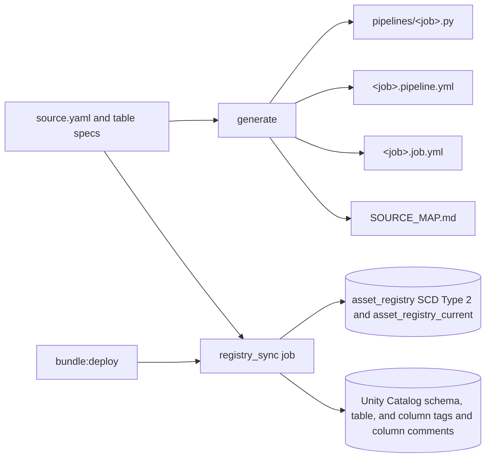
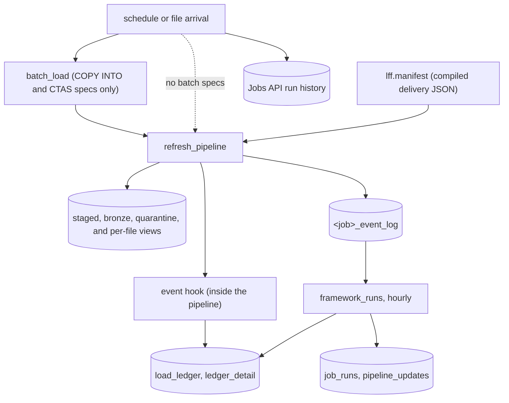
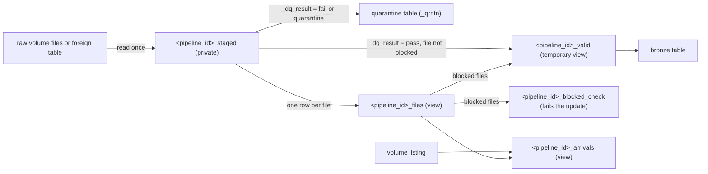
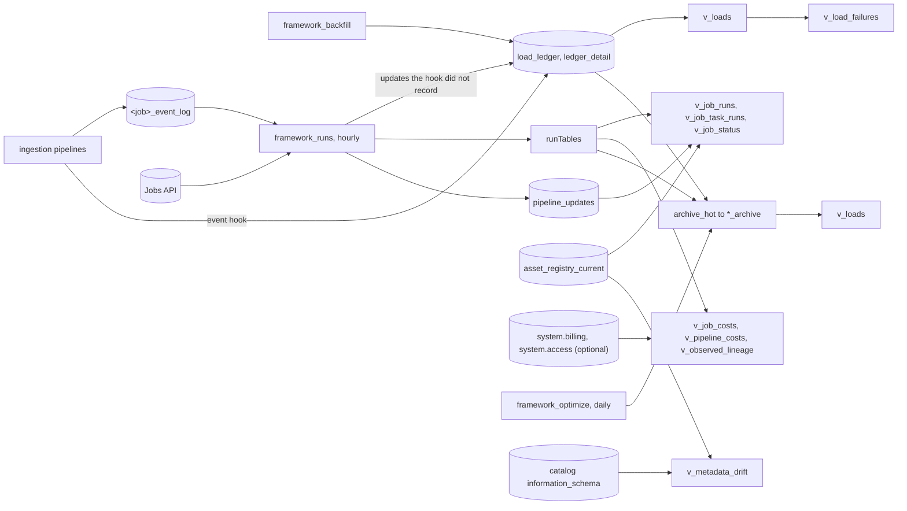
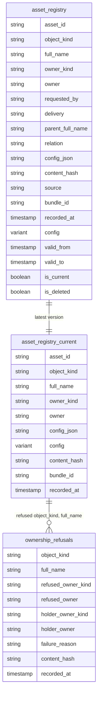
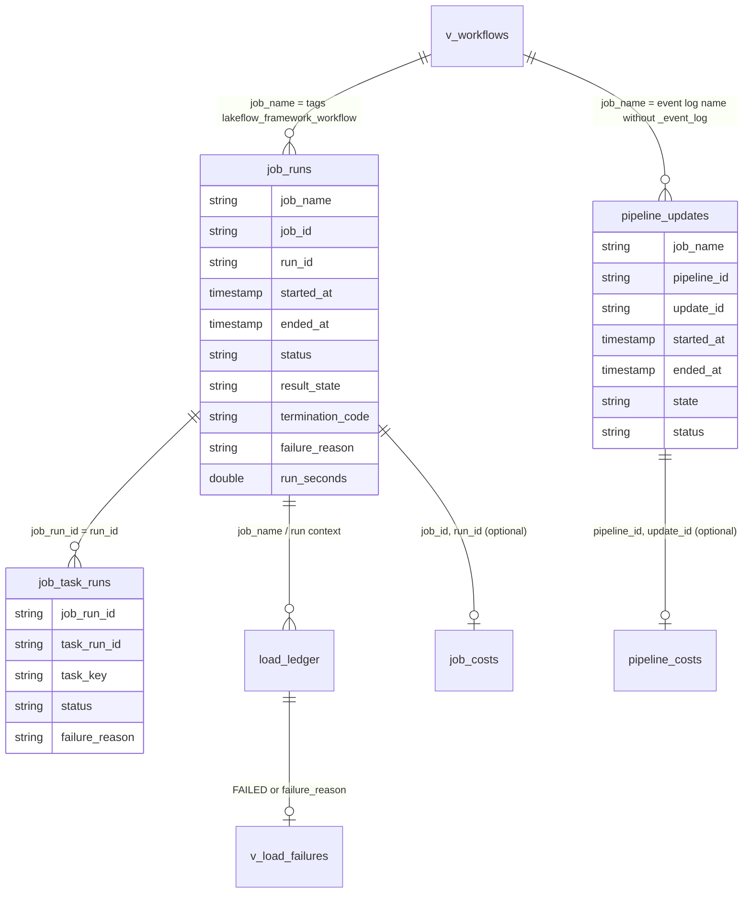
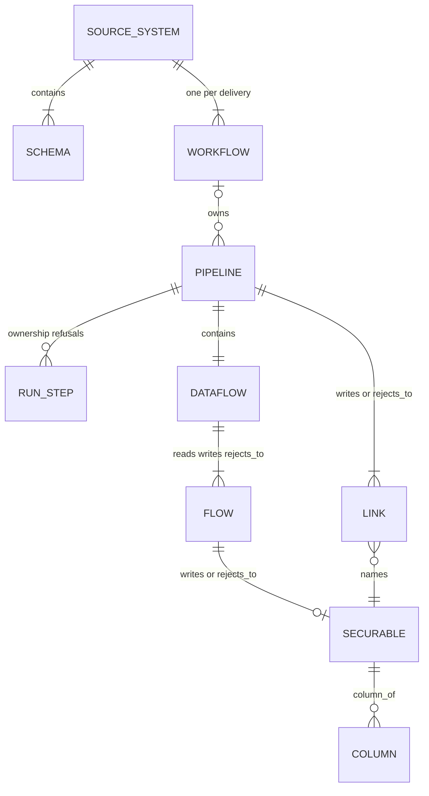
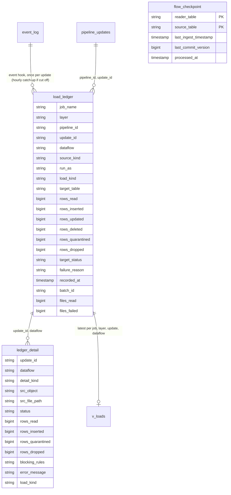

# Architecture

How the framework is put together: the folders, the code, every table it writes, and how data and metadata move between them. The run path step by step is in [END_TO_END.md](END_TO_END.md); the YAML contracts are in [README.md](README.md).

## Layout

Folders at the repository root start with `framework_`.

- `framework_lff_lib` is the wheel. Public names are `build_pipeline`, `validate_configs`, and `LoadMethod`.
- `framework_bundle` deploys that wheel and the frozen metadata registry: `sql/framework_meta.sql` and `sql/system_views.sql`, the DDL jobs, hourly `framework_runs` (records job runs and pipeline updates, and writes the `load_ledger` row of any update whose own hook did not finish), daily `framework_optimize` (compaction, `archive_hot`), and `framework_backfill` (reloads files of any one table, or refreshes it; run it with `./run.sh backfill`). See [META_MODEL_REVIEW.md](META_MODEL_REVIEW.md).
- `framework_ingestion` is source to bronze: source systems, table specs, and the pipelines and jobs generated from them.
- `framework_curation/<domain>/<project>` is one bundle per project for silver, gold, and data products.
- `framework_examples/ingestion` is the set of specs to copy for each source kind. `framework_examples/consumer` is the original single-bundle example and is reference only.
- `framework_tests` holds package tests. They copy sample YAML and use fake Spark objects; they do not start a cluster.
- `framework_docs` is this documentation.

Three things are kept apart on purpose: the **meta framework** (registry and metrics), **source ingestion** (domain-owned, shared), and **curation** (silver, gold, and data products, one project owner each). They deploy separately and have different owners.

## Modules

Each module imports only the ones listed. `ingestion` is a thin re-export of `sources` / `generate` / `scaffold`.

| Module | Imports | What it does |
| --- | --- | --- |
| `sqlnames` | nothing | Identifier checks, SQL string quoting, shared `spark_rows` / `merge_sql` |
| `spark_types` | nothing | Optional `pyspark.sql.types` plus `require_writer` so registry writes never silently no-op |
| `config` | `sqlnames` | Validates specs, joins a spec with its `source.yaml`, and holds `PipelineConfig` |
| `load` | `config`, `sqlnames` | Load strategies: Auto Loader options, `schemaHints`, and batch SQL. No `pyspark` |
| `quality` | `config`, `load` | Rules to SQL predicates, `_dq_failed_rules`, each row's `_dq_result` (`pass`, `quarantine`, `drop`, `fail`), the rule actions, and the warn expectations |
| `volume_listing` | nothing | Lists a volume folder by name, size and arrival time, including files with no bytes (which Spark's `binaryFile` reader leaves out) |
| `pipeline` | `config`, `load`, `quality`, `volume_listing` | `assemble` builds the dataset graph; `build_pipelines` reads `lff.manifest` (legacy `lff.specs`) and registers with `pyspark.pipelines`; `stage_frame` is the staging step a backfill shares; installs the ledger hook |
| `pipeline_metrics` | `load_metrics`, `sqlnames` | The event hook: folds one update's events into `load_ledger` rows and writes them (with `ledger_detail`) once, in parallel; reads the per-file and arrivals views |
| `load_catchup` | `pipeline_metrics`, `metadata` | Replays a cut-off update's event log through the same recorder and writes its rows (`framework_runs`, hourly) |
| `backfill` | `pipeline`, `pipeline_metrics`, `quality`, `volume_listing` | Reloads chosen files of one table through the pipeline's own staging step, or starts a full refresh of it |
| `rule_check` | `quality`, `config` | Runs every quality rule on a SQL warehouse before deploy (`check:rules`) |
| `silver_reader` | `sqlnames` | Reads only what is new from a source; appends SUCCEEDED to `flow_checkpoint` after commit |
| `metadata` | `config`, `quality`, `sqlnames` | Registry rows, ownership-refusal payloads, DDL text (package data), and SQL lookups |
| `registry` | `metadata`, `spark_types`, `sqlnames` | The only registry writer: definitions, ownership refusals, retirement, and DDL apply |
| `load_metrics` | `sqlnames` | The ledger's column list and the older event-log SQL it came from; the pipeline now writes its own rows (`pipeline_metrics`) |
| `unity` | `sqlnames` | Applies schema, table, and column tags and column comments to Unity Catalog |
| `runs` | `sqlnames`, `spark_types` | Records job runs from the Jobs API / `system.lakeflow` and pipeline updates from event logs |
| `sources` | `config`, `metadata`, `unity` | Reads `source.yaml` and specs; builds deploy registry rows |
| `generate` | `config`, `sources`, `unity` | Writes `SOURCE_MAP.md` and `.build/` pipelines, jobs, and delivery manifests |
| `scaffold` | `config`, `sources` | `new-source` / `new-table` templates |
| `ingestion` | `sources`, `generate`, `scaffold` | Public facade used by the CLI, projects, and tests |
| `projects` | `config`, `ingestion` | Validates `project.yaml` and writes the project maps |
| `cli` | all of them, most on first use | `lakeflow-framework` commands, called by `run.sh` and the job tasks |

Load strategies return option dictionaries and SQL strings. Public `LoadMethod` names the MVP methods (`VOLUME_FILES`, `DATABASE_TABLE`) and the frozen ones (`AUTOLOADER`, `COPY_INTO`, `CTAS`). `build_pipeline` touches Spark and `pyspark.pipelines` only when the caller passes nothing, which is the generated one-line pipeline file on a cluster. The CLI validates and writes files without a session. Generated jobs default to `performance_target: STANDARD` (override per source in `source.yaml`).

## Flows

### From a spec to deployed resources

One delivery of one source system is one pipeline and one job, named `<source_system>_<delivery>`. `framework_bundle` deploys first and runs `framework_ddl`, then `framework_system_views`, which does nothing unless the target sets `system_views` to `true`. `framework_ingestion` deploys next and runs `registry_sync`, the only writer of definitions. At every deploy it:

1. Writes every source system, schema, workflow, pipeline, dataflow, flow, table, link, and column the bundle defines. A new or changed definition gets a new version in `asset_registry`, and the version it replaces is closed.
2. Retires what the bundle no longer defines. Each such object gets a deletion version and leaves `asset_registry_current`.
3. Sets the tags on each schema, table, and column, and each column comment, in Unity Catalog. It changes only what differs.

`run.sh deploy` fails when `registry_sync` fails, so a deploy whose metadata did not load is a failed deploy. The generated job also carries tags: the `lakeflow_framework_workflow` tag the run views join on, and the source's `domain`, `owner`, `owner_email`, `source_kind`, `delivery`, `requested_by`, and `data_domain`.

### A delivery run

The job has one task, **refresh_pipeline**. (Frozen `cloud_files` methods add **batch_load** before it.) There is no recording task after it. The pipeline records its own loads: an **event hook** inside the pipeline folds the update's events into one `load_ledger` row per table and one `ledger_detail` row per file (or curated input), and writes both at the same time. Every count is a number, and a table that failed or could not register is `FAILED` with the error. The hook starts as soon as every flow of the delivery has finished, because serverless can shut the pipeline down within seconds of a failure and cancel a write still running. If a write is cut off anyway, the update has no `load_ledger` row, and the hourly `framework_runs` finds it from the event log and writes it through the same recorder (that path does not run the missing-file check below). Insert only; no MERGE; no scan of target tables. The pipeline validates its deployed spec files itself, so a run neither writes nor waits on the registry for specs. **A pipeline's own restart of a failed update is turned off** (`pipelines.numUpdateRetryAttempts` is `0` in the generated pipeline): a file blocked by a `fail` rule fails the update on purpose, and a restart would find the file already read and finish, hiding the failure.

### Inside one pipeline: source to bronze and quarantine

The staging table computes `_dq_failed_rules` once per row, and from it `_dq_result` (`fail`, `quarantine`, `drop` or `pass`; a row that broke only warn rules passes). Both are stored with the row, so a rule changed later never reclassifies a file already read. It carries one warn expectation per rule, so pass and fail counts reach the event log. Bronze is an append streaming table, an Auto CDC streaming table (`dedup: true`, or database `merge`), or a materialized view (database `snapshot`). The frozen `cloud_files` methods add a raw table before the staging table.

A table loaded from **files** has three more datasets, all in the pipeline's own schema (`framework_meta`), not beside bronze:

- **`<pipeline_id>_files`** is a materialized view with one row per file of this run: rows read, loaded, quarantined, dropped and blocked, and a status (`PROCESSED`, `WARNING`, or `FAILED` when a `fail` rule blocked it). It reads only this run's rows of the staging table (found by `_batch_id` and the load time the staging table is clustered on). The ledger is written from it, and the valid view uses it to keep a blocked file's good rows out of bronze (a left anti-join on the blocked files).
- **`<pipeline_id>_blocked_check`**, only when a rule has `on_fail: fail`, is a materialized view over the blocked files with an `expect_all_or_fail`. It runs after bronze and quarantine have finished, so the file is already marked read when it fails the update. This is the only way to fail the run and still consume the file: a failing load flow would leave Auto Loader's checkpoint behind, and the next run would read the file again.
- **`<pipeline_id>_arrivals`**, only when the table expects a file each run (`source.expect_file`), lists the files that arrived since the previous regular run and says whether this run read rows from each. The hook uses it to record a run with no file, or a file with no rows, as `FAILED` while the job still succeeds.

A database source has no files, so a `fail` rule there is a run-level `expect_all_or_fail` on the staging table.

### Metrics and governance

## Data model

Editable Lucidchart ([Lakeflow framework_meta](https://lucid.app/lucidchart/4713f75e-9ce7-407b-a31c-5444a17b9ec9/edit)) — tabs: **1. ERD**, **2. catalog (NOW)**, **3. Team process**, **4. Ingestion kinds**, **5. Quarantine**, **6. Backfill**, **7. Metadata via configs**, **8. Future Connect/SFTP/SharePoint**. Deploy vs run flow: [Deploy vs Run](https://lucid.app/lucidchart/3bfb81a4-d831-46b1-9f9f-6950ade7d5dc/edit) (tabs: Deploy, Run, What writes what, kinds, quarantine, backfill, future). Purpose of every table and view: [framework_meta_data_dictionary.html](framework_meta_data_dictionary.html) (open in a browser; use **Download HTML** for an offline copy).

### Every table, by owner

| Table | Schema | Written by | Grain | Kind |
| --- | --- | --- | --- | --- |
| `asset_registry` | `framework_meta` | `registry_sync` | One version of one definition (`bundle_id` = which deploy wrote it) | Delta, SCD Type 2 |
| `asset_registry_current` | `framework_meta` | `registry_sync` | One row per `(object_kind, full_name)` | Delta, merged |
| `{job}_event_log` | `framework_events` | each delivery pipeline | Lakeflow event log (out of `framework_meta` so SHOW TABLES scales) | Delta |
| `ownership_refusals` | `framework_meta` | `registry_sync` | One refused definition (another owner already holds the name) | Delta, insert-only |
| `job_runs` | `framework_meta` | hourly `framework_runs` | One append per observed run state (retries OK) | Delta, append-only; `v_job_runs` keeps latest `(job_id, run_id)` |
| `job_task_runs` | `framework_meta` | hourly `framework_runs` | One append per observed task state | Delta, append-only; `v_job_task_runs` keeps latest `(job_run_id, task_run_id)` |
| `pipeline_updates` | `framework_meta` | `framework_runs` | One update of an ingestion pipeline | Delta, merged on `(pipeline_id, update_id)` |
| `load_ledger` | `framework_meta` | the pipeline's event hook; `framework_backfill`; hourly `framework_runs` for an update whose hook was cut off | One table's load in one update: `source_kind`, `run_as`, `load_kind` (regular\|backfill\|catchup); counts (`rows_read`, `rows_inserted`, `rows_updated`, `rows_deleted`, `rows_quarantined`, `rows_dropped`, `files_read`, `files_failed`, never NULL), status, error, `batch_id` | Delta, insert-only, ~90-day hot |
| `ledger_detail` | `framework_meta` | the same writers | Child unit-of-work (`detail_kind=file` or `input`): path/FQN, status (`PROCESSED`, `WARNING`, `FAILED`), counts, rules, `error_message`, `load_kind` | Delta, insert-only, ~90-day hot |
| `load_ledger_archive` / `ledger_detail_archive` / `job_runs_archive` / `job_task_runs_archive` / `pipeline_updates_archive` | `framework_meta` | `framework_optimize` `archive_hot` | Rows moved off hot after 90 days; `PARTITIONED BY archive_quarter` | Delta, forever |
| `ddl_applied` | `framework_meta` | `framework_ddl` / `apply_ddl` | One SQL file hash per successful apply | Delta, insert-only |
| `<pipeline_id>_staged` | none (private) | ingestion pipeline | One source row | Private streaming table or materialized view |
| `<pipeline_id>_files`, `_blocked_check`, `_arrivals` | `framework_meta` | ingestion pipeline (file sources) | The latest run's files; the blocked files of that run; the files that arrived since the previous run | Materialized views (see "Inside one pipeline") |
| `backfill_state` | `framework_meta` (a volume) | `framework_backfill` | The Auto Loader schema and checkpoint of one backfill run | Volume; a finished run's folder can be deleted |
| bronze, `<schema>.<table>` | `<source>_bronze` | ingestion pipeline | One passing row, or one row per key with Auto CDC | Streaming table or materialized view |
| quarantine, `<table>_qrntn` | `<source>_bronze` | ingestion pipeline | One failing row | Streaming table or materialized view |

The registry tables change once per deploy, hot→archive once a day, and hourly `framework_runs` records job runs and pipeline updates. A delivery run writes its own data tables, event log under `framework_events`, and, from the pipeline's event hook, its rows in `load_ledger`, `ledger_detail`. Schemas, volumes, and foreign catalogs exist before a deploy. Until go-live, drop `framework_meta` (and recreate `framework_events` via DDL) to pick up new columns; `CREATE IF NOT EXISTS` will not ALTER existing tables.

### Registry, physical

`asset_registry` is SCD Type 2 on `(object_kind, full_name)`. Each version has `valid_from`, `valid_to`, `is_current`, and `is_deleted`, plus a stable `asset_id` (SHA-256 of source coordinates). A definition has exactly one current version. When a deploy changes it, one `MERGE` sets the old version's `valid_to` and `is_current = false` and inserts the new one, so a retried deploy cannot leave the history half written. When a deploy no longer defines it, the current version is closed and a deletion version (`is_deleted = true`) becomes current. If the definition comes back, the deletion version is closed in turn. Rows are never deleted, and only `valid_to` and `is_current` are ever updated. `ownership_refusals` and `load_ledger` are events and stay insert-only. A version is `(object_kind, full_name, valid_from)`. The definition active at time `t` is the version with `valid_from <= t` and `valid_to` null or later, in `v_asset_registry_history`.

`asset_registry_current` has every column of `asset_registry` except the four SCD columns: it is the current, non-deleted version of each definition. The diagram shows the keys and the columns most queries use.

| Table | Clustered by |
| --- | --- |
| `asset_registry` | `(owner, object_kind, full_name)` |
| `asset_registry_current` | `(owner, object_kind, full_name)` |
| `ownership_refusals` | `(full_name, recorded_at)` |

Every registry table sets `delta.autoOptimize.optimizeWrite` and `delta.autoOptimize.autoCompact`.

`config` is `config_json` parsed to `VARIANT`; `content_hash` is computed over `config_json`, so both are kept.

### Runs, from the Jobs API and the event logs

Run outcomes do not need the system tables. `framework_runs` copies them hourly:

- **Job runs.** Append-only (like `load_ledger`): the hourly `framework_runs` job INSERTs; `v_job_runs` / `v_job_task_runs` keep the latest `recorded_at` per key — no MERGE. Catch-up prefers one INSERT SELECT over `system.lakeflow.job_run_timeline` / `job_task_run_timeline` (needs `SELECT` on `system.lakeflow`); without it, Jobs API walk. `status` is `RUNNING`, `SUCCEEDED`, `SKIPPED`, or `FAILED` (`SUCCESS_WITH_FAILURES` → `FAILED` on the API path). System-table freshness is typically up to about an hour.
- **Pipeline updates.** The `pipeline_updates` task reads the `update_progress` events in every `<job>_event_log`. An update with an event in the window is read whole. `state` is the last update state, and `status` is `SUCCEEDED`, `FAILED`, `CANCELED`, or `RUNNING`.
- **Cost, optional.** `system_views.sql` joins `job_runs` and `pipeline_updates` to `system.billing.usage` and `list_prices` as `v_job_costs` and `v_pipeline_costs`. It needs `SELECT` on `system.billing` and runs only when the target sets `system_views` to `true`. `v_observed_lineage` there needs `system.access`.

A run that started and ended between two passes is still listed: the window starts before the latest recorded start. Runs older than the Jobs API keeps (60 days) are only in `job_runs` if `framework_runs` saw them in time.

### Registry, logical

Every box is a row in `asset_registry`, except an ownership refusal which lands in `ownership_refusals`. `parent_full_name` and `relation` are the edges.

| Kind | `full_name` | Parent | `relation` | What `config` holds |
| --- | --- | --- | --- | --- |
| `source_system` | source system name | none | none | `source.yaml`: domain, owner email, source kind, engine, foreign catalog, raw volume, and each delivery with its schedule or trigger and job name |
| `schema` | `<catalog>.<schema>` | the source system | `contains` | The layers the source writes there, and the tags `registry_sync` sets on the schema |
| `workflow` | `job_name` | none | none | Every `pipeline_id` in that job, every requester, the source system and kind, and the delivery's schedule or trigger |
| `pipeline` | `pipeline_id` | `job_name` when set | `owns` | Canonical spec and compiled rules |
| `dataflow` | `pipeline_id` | the pipeline | `contains` | Raw layer, bronze table, and quarantine table |
| `flow` | `<pipeline_id>.raw`, `.bronze`, `.quarantine` | the dataflow | `reads`, `writes`, or `rejects_to` | Volume path, or table name and layer |
| `streaming_table`, `table`, `materialized_view` | `<catalog>.<schema>.<table>` | the flow name | `writes` or `rejects_to` | Layer, domain, data domain, team, technical owner, classification, PII, `pipeline_id`, job name, and load method |
| `link` | `<pipeline_id>-><table>` | pipeline | `writes` or `rejects_to` | Child table name |
| `column` | `<table>.<column>` | table name | `column_of` | Ordinal, type, description, classification, PII |
| `ownership_refusals` row | the refused pipeline or table | none | none | refused owner, holder, and `failure_reason` |

A file source whose raw layer is a volume still has a `raw` flow. That flow records the volume path and has no securable. A `cloud_files` raw flow has a securable, because its raw layer is a Delta table. A database load has no raw flow. Every row carries `owner_kind`, `owner`, `requested_by`, and `delivery`. A raw table is a `streaming_table` for Auto Loader and a `table` for COPY INTO and CTAS. Bronze and quarantine are a `materialized_view` for CTAS and for a database `snapshot`, and a `streaming_table` otherwise. Bronze written by Auto CDC (dedup, or database `merge`) stays a `streaming_table`.

Each object is hashed on its own document. A job rename versions the workflow, the pipeline, and its tables, because the job name is a table tag. It does not version a column whose own fields did not change. A column hash covers ordinal, data type, description, classification, and PII. The column name is the key, so a rename is a different column.

### Data tables

What each table the pipeline writes holds, beyond the spec's `columns`:

| Table | Extra columns | Rows |
| --- | --- | --- |
| `<pipeline_id>_staged` | `_src_file_path`, `_src_file_name` (files), `_src_row_hash`, `_ingest_timestamp`, `_rescued_data` (Auto Loader on CSV, delimited, JSON, text), `_dq_failed_rules`, `_dq_result` (files); `_batch_id` is added when the row is staged | Every source row |
| bronze | The same lineage columns, without `_dq_failed_rules` and `_dq_result` | Rows that passed, from files that were not blocked; with Auto CDC, the latest row per key by the watermark |
| quarantine | The same lineage columns and `failed_rules` | Rows that broke a `quarantine` or `fail` rule, including the bad rows of a blocked file |

Every published table gets a comment, `table_properties` (`quality` = its layer, and `lakeflow_framework.pipeline_id`), and liquid clustering. At deploy, `registry_sync` sets these Unity Catalog tags:

| On | Tags | From |
| --- | --- | --- |
| each schema the source uses | `domain`, `owner` (the source system), `owner_email`, `source_kind`, `layer`, `foreign_catalog`, `engine` | `source.yaml`, and the layers its specs write there |
| each table | `classification`, `domain`, `pii`, `data_domain`, `team`, `technical_owner`, `layer`, `pipeline_id`, `job_name`, `load_method`, `owner`, `requested_by`, `delivery` | the table spec, joined with `source.yaml` |
| each column | `classification`, `pii`, and `description` as the comment | the spec's `columns` |

A tag with no value is not set, and one the spec no longer gives is unset. Tags the framework does not own are left alone. A value is trimmed and cut to 255 characters, within the Unity Catalog limit. A schema or table that does not exist yet is skipped and tagged at the next deploy.

### Metrics, physical

Archive tables are not shown: after ~90 days, load & recon (`load_ledger`, `ledger_detail`) and job/run tracking (`job_runs`, `job_task_runs`, `pipeline_updates`) move to matching `*_archive` tables (`PARTITIONED BY archive_quarter`). `v_loads` / `v_ledger_detail` / `v_job_runs` read hot ∪ archive.

`job_name` comes from the event log's table name, `<job>_event_log`. `pipeline_id` is the Databricks pipeline id, which joins to `v_pipeline_updates` with `update_id`. `dataflow` is the spec's `pipeline_id`, which joins to the registry. Rule counts land on the ledger from staged `flow_progress` when present.

**Per-load counts.** `v_loads` (or `load_ledger`) is the sole recon SoR for bronze, silver, gold, and product. The pipeline's event hook writes one row per registered dataflow per update; a table with no progress, or one that failed to register, is `FAILED` with the error, so partial delivery failures stay visible. Never MERGE. Filter on `layer` for one medallion layer (`WHERE layer = 'bronze'` for bronze only). `v_loads` unions 90-day hot with forever archive for dashboards. `v_load_failures` joins loads to job/task `failure_reason` for repair.

**What the counts mean.** For an append load, `rows_read ≈ rows_inserted + rows_quarantined + rows_dropped` (blocked good rows of a fail-ruled file are folded into `rows_dropped`); the hook logs a warning when the identity does not hold. `rows_inserted` / `rows_updated` / `rows_deleted` are what the target flow changed. A load that failed or read nothing has every count 0, never NULL. `files_read` counts the files of the run and `files_failed` those recorded `FAILED`.

**When a load is `FAILED` though the job succeeded.** Three things set `target_status` to `FAILED`, and the first also fails the job:

| Cause | Job | Ledger reason |
| --- | --- | --- |
| A file broke a `fail` rule (a table loaded from files) | **Fails** | `N of M file(s) blocked by fail rules, none of their rows loaded to <bronze>: <file> (<rule>)` |
| A table that expects a file got none | Succeeds | `no file arrived in <folder> since the previous run` |
| A file arrived with no rows (0 bytes, or a header only) | Succeeds | `N file(s) arrived with no rows: <names>`, and a `ledger_detail` row `FAILED` for each |

A backfill records the same facts (plus `file not found` for a name that is not in the folder) in `load_ledger` and `ledger_detail` with `load_kind = 'backfill'` and an `update_id` that starts `backfill-`, and its job succeeds with a `WARNING:` line.

**Writes.** `load_ledger` and `ledger_detail` are appended at the same time, because the pipeline shuts down within seconds of a failed update and cancels a write still running. The `load_ledger` row is what says an update was recorded: if it is missing, the hourly catch-up writes the whole update from the event log (it skips detail rows already written). If it is there but a `ledger_detail` write was cut off, those file rows are not recovered, because the per-file view holds only the latest run.

## Views

```mermaid
flowchart TD
  asset_registry --> v_asset_registry_history
  asset_registry_current --> v_asset_registry_current
  v_asset_registry_current --> v_source_systems
  v_asset_registry_current --> v_schemas
  asset_registry_current --> v_lineage
  asset_registry_current --> v_ownership_conflicts
  asset_registry_current --> v_metadata_drift
  load_ledger --> v_ledger_detail
  ledger_detail --> v_ledger_detail
  ledger_detail_archive --> v_ledger_detail
  information_schema[catalog information_schema] --> v_metadata_drift
  v_asset_registry_current --> v_workflows
  v_asset_registry_current --> v_pipelines
  v_asset_registry_current --> v_dataflows
  v_asset_registry_current --> v_flows
  v_asset_registry_current --> v_tables
  v_asset_registry_current --> v_columns
  v_asset_registry_history --> v_column_history
  ownership_refusals --> v_ownership_refusals
  v_workflows --> v_job_status
  v_job_runs --> v_job_status
  v_workflows --> v_job_runs
  job_runs --> v_job_runs
  job_task_runs --> v_job_task_runs
  pipeline_updates --> v_pipeline_updates
  v_workflows --> v_pipeline_updates
  load_ledger --> v_loads
  load_ledger --> v_loads
  load_ledger_archive --> v_loads
  v_loads --> v_load_failures
  v_job_runs --> v_load_failures
  v_job_task_runs --> v_load_failures
  v_job_runs --> v_job_costs
  v_pipeline_updates --> v_pipeline_costs
  asset_registry_current --> v_observed_lineage
  system_tables["system.billing, system.access (optional)"] --> v_job_costs
  system_tables --> v_pipeline_costs
  system_tables --> v_observed_lineage
```

`framework_meta.sql` creates every view except three; `system_views.sql` creates `v_job_costs`, `v_pipeline_costs`, and `v_observed_lineage`, in their own job because they need system table grants. That job runs them only when the target sets `system_views` to `true`. The views read fields from `config` with `config:path`. `v_job_status` is each workflow and its latest run from `v_job_runs` (recorded hourly by `framework_runs`). `v_ownership_refusals` lists every definition `registry_sync` refused. `v_loads` keeps the latest `load_ledger` row per job, layer, update, and dataflow (a repeated write may append again), with the new counts shown as 0 when empty. `v_loads` unions hot and archive; `v_load_failures` surfaces what failed and why, including the dropped, blocked and file counts. Frozen schema: [META_MODEL_REVIEW.md](META_MODEL_REVIEW.md).

`v_asset_registry_history` reads the SCD columns from `asset_registry`; it does not window. Filter `owner`, the first clustering key, to read less. `asset_registry_current` is keyed by `object_kind` and `full_name`: a pipeline or table has one current row. `v_source_systems` and `v_schemas` list the current source systems and the schemas they use, with their tags. `v_metadata_drift` covers schema, table, and column tags, with `securable` saying which.

How the views join their sources:

| View | Joined on |
| --- | --- |
| `v_job_runs`, `v_job_task_runs` | `job_runs.job_name` (the job's `lakeflow_framework_workflow` tag) = `v_workflows.job_name` |
| `v_pipeline_updates` | `pipeline_updates.job_name` (the event log's name) = `v_workflows.job_name` |
| `v_loads` | hot `load_ledger` ∪ `load_ledger_archive`, latest per `job_name`, `layer`, `update_id`, `dataflow` |
| `v_ledger_detail` | hot `ledger_detail` ∪ `ledger_detail_archive`, latest per file/input key |
| `v_load_failures` | loads + job/task runs where status FAILED or `failure_reason` set |
| `v_job_costs` | `system.billing.usage` `usage_metadata.job_id` and `job_run_id` = `job_runs.job_id` and `run_id` |
| `v_pipeline_costs` | `usage_metadata.dlt_pipeline_id` and `dlt_update_id` = `pipeline_updates.pipeline_id` and `update_id` |
| `v_observed_lineage` | `table_lineage.target_table_full_name` = the dataflow's bronze or quarantine table |
| `v_metadata_drift` | `information_schema` schema, table, and column names = the registry names, lower-cased |

## Design choices

**The Unity Catalog volume is the raw layer for file kinds.** `sftp_files` and `sharepoint_files` keep the files as delivered and have no raw Delta table. A database has no raw layer. `cloud_files` writes a raw table first. Its path may be `abfss://`, `s3://`, or a `/Volumes/<catalog>/<schema>/<volume>` path. Quarantine and bronze are always built, and both are filtered by the quality rules.

**The source system owns bronze.** Many teams can add specs under one source. The registry records `requested_by` for the team that asked. `registry_sync` refuses a second source system for the same table. Silver, gold, and data products are owned by a project.

**A delivery is the pipeline.** Every table in a delivery loads in one Lakeflow pipeline and one job. A second schedule is a second delivery in that source's `source.yaml`. A new table in an existing delivery is a spec file and nothing else. Cross-table waits belong to curation, not to bronze.

**Each source is read once.** A pipeline cannot send one read to two tables, and a temporary view runs again for every reader, so a private staging table holds the one read. Bronze holds only clean rows; quarantine keeps the failing rows with `failed_rules`.

**Facts live once.** The source's kind, raw volume, and foreign catalog are in `source.yaml`. A table spec holds only the table. `compose_document` joins them, so a new table cannot disagree with its source.

**Everything operational is generated from the specs.** Pipelines, jobs, and maps come from one model, so the map is the deployed state. Generated files are marked, deleted when unneeded, and checked in CI.

**Load methods are strategies** with one contract: name, supported formats, the raw relation, options, and batch SQL. The pipeline template reads the strategy. It does not subclass a reader hierarchy.

**Quality rules are functions from config to SQL.** The template does not know how a not-null rule was produced.

**The registry records intent; the platform records what happened.** Definitions and owners are in the registry, written once per deploy. Row counts and pipeline update states come from the event logs, job runs from the Jobs API, and, where the grants exist, cost from `system.billing` and observed lineage from `system.access`. The views join them.

**System tables are preferred, not required, for catch-up.** Hourly job-run catch-up prefers `system.lakeflow` and falls back to the Jobs API without the grant. Cost and observed lineage still need `system.billing` / `system.access` and stay behind `system_views`. Load recording never waits on system tables: the pipeline's hook writes its own rows.

**Unity Catalog holds the governance metadata.** The spec and `source.yaml` are the source; `registry_sync` writes them to Unity Catalog at every deploy and changes only what differs. `v_metadata_drift` shows anything that disagrees.

**Definitions are SCD Type 2; events are not.** A definition has a life: it is created, changed, and removed, and `asset_registry` keeps every state with when it held. A refusal or a load-metrics append happens once, so `ownership_refusals` and `load_ledger` only append.

**One bundle retires one owner kind.** `registry_sync` retires every `source_system`-owned object in the catalog that `framework_ingestion` no longer defines. That is right while `framework_ingestion` is the only bundle that registers source systems in a catalog. A second bundle that registers source systems into the same catalog, or two developers deploying different branches into one dev catalog, would retire each other's definitions.

**Auto Loader options are a fixed map.** A format allow-list, `max_files_per_trigger` (1000 when the spec omits it), JSON `multiline` only when the spec sets it, a required CSV delimiter, Excel `header_rows` of 0 or 1, and a required Excel `data_address`. The pipeline owns the checkpoint and `cloudFiles.schemaLocation`. CSV, delimited text, and JSON get `cloudFiles.schemaHints` from `columns`, and `source.file_events: true` sets `cloudFiles.useManagedFileEvents`.

Lakeflow Connect is how SharePoint, and later other managed sources, will reach the raw volume or bronze. See the [roadmap](ROADMAP.md).

## Behaviour that still needs a workspace

See the list in [END_TO_END.md](END_TO_END.md#checked-on-a-real-workspace).
