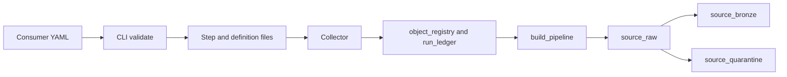

# Architecture

## The repository this replaces

`JLLT-EDP-Ingestion-develop.zip` is about 445 entries. It has 39 `setup.py` files and 32 directories under `eif_readers/`. `plugin_discovery.py` is 864 lines and mixes entry points, a filesystem scan, and `sys.path` changes. The same dataclass template is copied in `eif_config_manager/templates/`, `eif_utils/ingestion/templates/`, and `ingestion/templates/`. There is no declarative pipeline, no bronze or quarantine layer, and no metadata tables.

The Auto Loader format checks and option map are kept: format allow-list, a positive `max_files_per_trigger`, a required CSV delimiter, Excel `header_rows` of 0 or 1, a required Excel `data_address`, Excel schema evolution left off, and the `cloudFiles` options for format, existing files, type inference, overwrites, file and byte limits, rescue on permissive text, header, delimiter, and path glob. Checkpoint path and `cloudFiles.schemaLocation` are not kept.

## Layout

Folders at the repository root start with `framework_`.

- `framework_src` is the wheel. Public names are `build_pipeline`, `validate_configs`, and `LoadMethod`.
- `framework_sql` is the registry DDL.
- `framework_bundle` builds the wheel and runs DDL, the collector, and daily `OPTIMIZE`.
- `framework_examples` is a consumer that only has YAML, one-line pipeline files, and a job.
- `framework_tests` runs without Spark.
- `framework_docs` is this documentation.

## Dependency direction

`pipeline` calls `config`, `quality`, `load`, and a metadata reader passed in. Load strategies return option dictionaries and SQL strings. They do not import `pyspark` or `pipelines`. `build_pipeline` touches Spark and `pyspark.pipelines` only when the caller does not pass fakes, which is the one-line pipeline file on a cluster. The CLI validates and writes files without a session.

## Design choices

Load methods are strategies with one contract: name, supported formats, whether raw is streaming or batch, options, and batch SQL. The pipeline template always builds raw, a valid view, quarantine, and bronze. It reads the strategy. It does not subclass a reader hierarchy.

Quality rules are functions from config to SQL. The template does not know how a not-null rule was produced.

The registry is two tables because the old procedures used a system, a stream, a job, an object, two attribute tables, a relationship table, and several logs. Attributes and relationships are columns. Run steps, failure text, and reconciliation are rows in `run_ledger`.

Lakeflow Connect is not used for these files. S3 and ADLS use Spark Declarative Pipelines. Connect remains the place to add SQL Server, PostgreSQL, and SharePoint later, as another strategy, without moving these folders.

## Migration

Keep, rewritten small: the Auto Loader checks and option map above.

Retire: the 39 per-handler packages, entry-point discovery, and the copied dataclass templates.

Defer: PostgreSQL, Azure SQL, SQL Server, DB2, SharePoint, and SFTP. Add each as a strategy. Prefer Lakeflow Connect for the databases and SharePoint when that work starts.

Do not copy into this package: the writers, the API handlers, the batchfile deploy tooling, or the `sys.path` changes.

## Behaviour that still needs a workspace

See the list in [END_TO_END.md](END_TO_END.md). Where the code assumes a syntax, the module states the assumption by using the current Lakeflow skill form and the docs list the check. `stored_as_scd_type` is the integer `1`. COPY INTO and CTAS are job statements. The collector, not the file pipeline, has a checkpoint.
