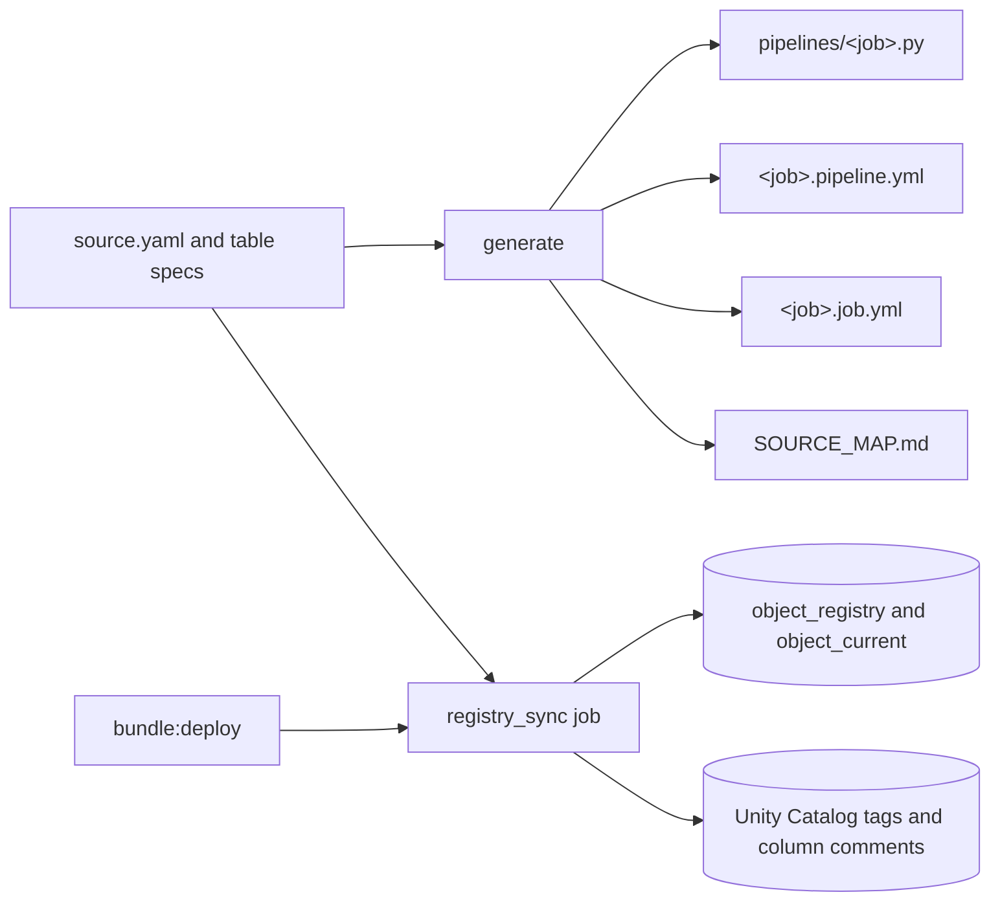
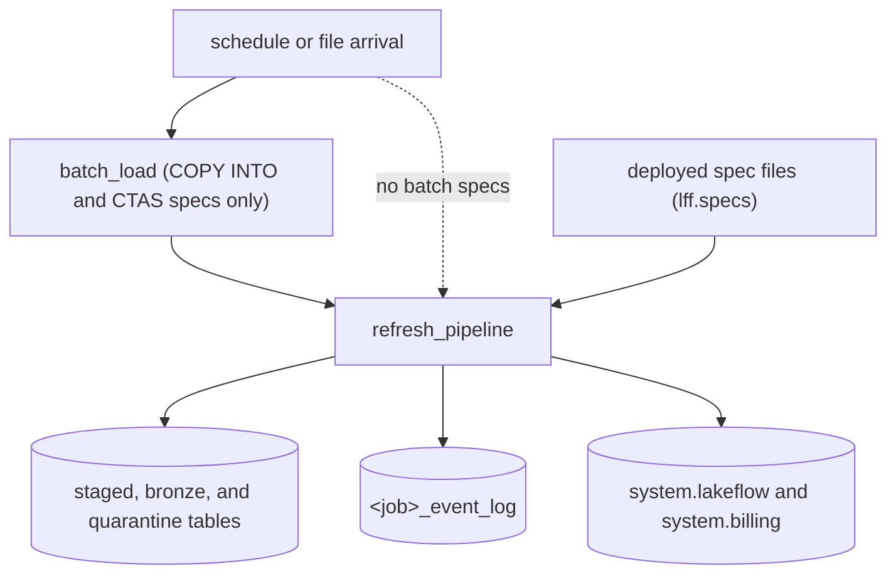
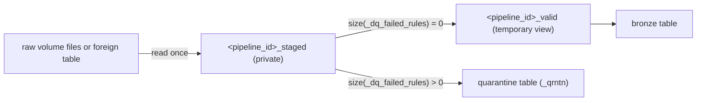
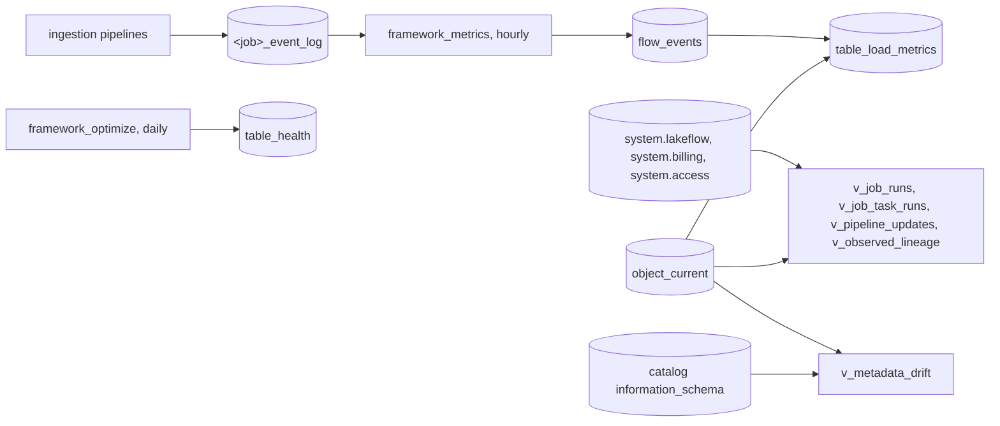
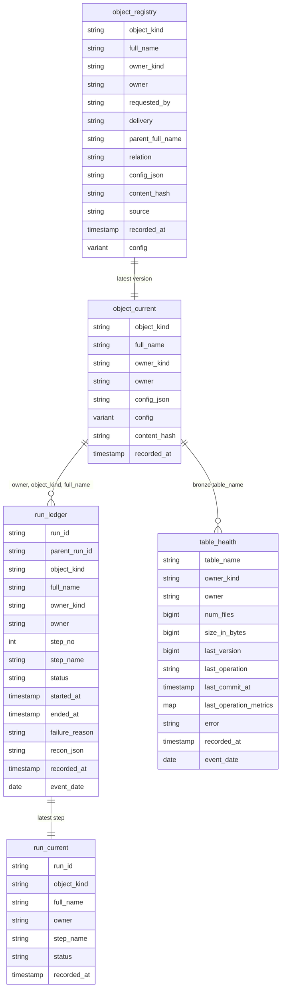
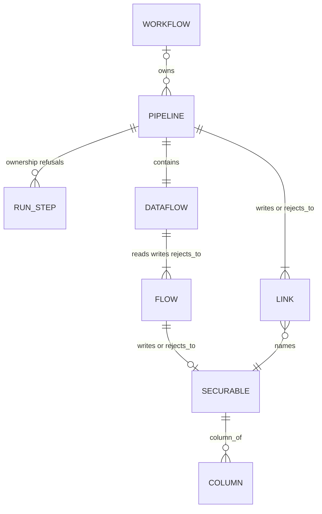
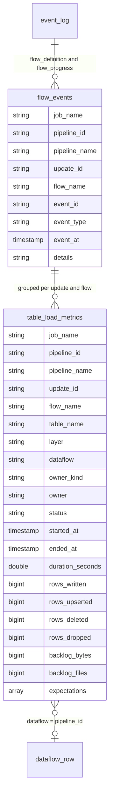
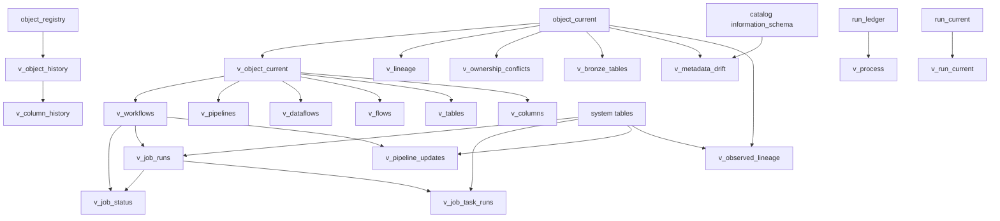

# Architecture

How the framework is put together: the folders, the code, every table it writes, and how data and metadata move between them. The run path step by step is in [END_TO_END.md](END_TO_END.md); the YAML contracts are in [README.md](README.md).

## Layout

Folders at the repository root start with `framework_`.

- `framework_lff_lib` is the wheel. Public names are `build_pipeline`, `validate_configs`, and `LoadMethod`.
- `framework_bundle` deploys that wheel and the metadata registry: `sql/framework_meta.sql` and `sql/system_views.sql`, the DDL jobs, the `framework_metrics` pipeline, and the daily `framework_optimize` job (compaction and table health).
- `framework_ingestion` is source to bronze: source systems, table specs, and the pipelines and jobs generated from them.
- `framework_curation/<domain>/<project>` is one bundle per project for silver, gold, and data products.
- `framework_examples/ingestion` is the set of specs to copy for each source kind. `framework_examples/consumer` is the original single-bundle example and is reference only.
- `framework_tests` holds package tests. They copy sample YAML and use fake Spark objects; they do not start a cluster.
- `framework_docs` is this documentation.

Three things are kept apart on purpose: the **meta framework** (registry and metrics), **source ingestion** (domain-owned, shared), and **curation** (silver, gold, and data products, one project owner each). They deploy separately and have different owners.

## Modules

Each module imports only the ones listed:

| Module | Imports | What it does |
| --- | --- | --- |
| `config` | nothing | Validates specs, joins a spec with its `source.yaml`, and holds `PipelineConfig` |
| `load` | `config` | Load strategies: Auto Loader options, `schemaHints`, and batch SQL. No `pyspark` |
| `quality` | `config`, `load` | Rules to SQL predicates, `_dq_failed_rules`, and the warn expectations |
| `pipeline` | `config`, `load`, `quality` | `assemble` builds the dataset graph; `build_pipelines` reads the specs in `lff.specs` and registers the graph with `pyspark.pipelines` |
| `metadata` | `config`, `quality` | Registry rows, step payloads for ownership refusals, and the registry SQL lookups |
| `registry` | `metadata` | The only registry writer: definitions with the ownership check, and the DDL |
| `unity` | `config`, `metadata` | Applies table and column tags and column comments to Unity Catalog |
| `health` | nothing | Records `DESCRIBE DETAIL` and `DESCRIBE HISTORY` figures per bronze table |
| `ingestion` | `config` | Reads `source.yaml` and specs, generates pipelines, jobs, and `SOURCE_MAP.md` |
| `projects` | `config`, `ingestion` | Validates `project.yaml` and writes the project maps |
| `cli` | all of them, most on first use | `lakeflow-framework` commands, called by `run.sh` and the job tasks |

Load strategies return option dictionaries and SQL strings. `build_pipeline` touches Spark and `pyspark.pipelines` only when the caller passes nothing, which is the generated one-line pipeline file on a cluster. The CLI validates and writes files without a session.

## Flows

### From a spec to deployed resources

One delivery of one source system is one pipeline and one job, named `<source_system>_<delivery>`. `framework_bundle` deploys first and runs `framework_ddl` and then `framework_system_views`. `framework_ingestion` deploys next and runs `registry_sync`, the only writer of definitions. It writes every deployed spec into the registry and applies the specs' tags and column comments in Unity Catalog.

### A delivery run

The job is one task, plus `batch_load` for frozen `cloud_files` methods. The pipeline validates its deployed spec files itself, so a run neither writes nor waits on the registry. Its outcome lands in the system tables and its row counts in its event log.

### Inside one pipeline: source to bronze and quarantine

The staging table computes `_dq_failed_rules` once per row and carries one warn expectation per rule, so pass and fail counts reach the event log. Bronze is an append streaming table, an Auto CDC streaming table (`dedup: true`, or database `merge`), or a materialized view (database `snapshot`). The frozen `cloud_files` methods add a raw table before the staging table.

### Metrics and governance

## Data model

### Every table, by owner

| Table | Schema | Written by | Grain | Kind |
| --- | --- | --- | --- | --- |
| `object_registry` | `framework_meta` | `registry_sync` | One version of one definition | Delta, insert-only |
| `object_current` | `framework_meta` | `registry_sync` | One row per `(object_kind, full_name)` | Delta, merged |
| `run_ledger` | `framework_meta` | `registry_sync` | One ownership refusal, or a job step from before steps moved to the system tables | Delta, insert-only |
| `run_current` | `framework_meta` | `registry_sync` | One row per `(owner_kind, owner, object_kind, full_name)` | Delta, merged |
| `table_health` | `framework_meta` | `framework_optimize` | One bronze table per day | Delta, append |
| `<job>_event_log` | `framework_meta` | each ingestion pipeline | One pipeline event | Event log table |
| `flow_events` | `framework_meta` | `framework_metrics` | One `flow_definition` or `flow_progress` event | Streaming table |
| `table_load_metrics` | `framework_meta` | `framework_metrics` | One job, pipeline, update, and flow | Materialized view |
| `<pipeline_id>_staged` | none (private) | ingestion pipeline | One source row | Private streaming table or materialized view |
| bronze, `<schema>.<table>` | `<source>_bronze` | ingestion pipeline | One passing row, or one row per key with Auto CDC | Streaming table or materialized view |
| quarantine, `<table>_qrntn` | `<source>_bronze` | ingestion pipeline | One failing row | Streaming table or materialized view |

The framework creates nothing outside `framework_meta` except the tables its pipelines publish. Schemas, volumes, and foreign catalogs exist before a deploy.

### Registry, physical

History is insert-only. A version is `(object_kind, full_name, recorded_at)`. A run step is `(run_id, step_no, status)`. The tables do not declare those as primary keys. A run matches the definition that was active when `owner`, `object_kind`, and `full_name` are equal and `started_at` is inside `[valid_from, valid_to)`.

`object_current` and `run_current` have every column of their history table; the diagram shows the keys and the columns most queries use.

| Table | Clustered by |
| --- | --- |
| `object_registry` | `(owner, object_kind, full_name)` |
| `object_current` | `(owner, object_kind, full_name)` |
| `run_ledger` | `(owner, event_date, run_id)` |
| `run_current` | `(owner, object_kind, full_name)` |
| `table_health` | `(owner, event_date, table_name)` |

`config` is `config_json` parsed to `VARIANT`; `content_hash` is computed over `config_json`, so both are kept. `recon_json` is no longer written; it stays so older rows still read.

### Registry, logical

Every box is a row in `object_registry`, except `RUN_STEP`, which is a row in `run_ledger`. `parent_full_name` and `relation` are the edges.

| Kind | `full_name` | Parent | `relation` | What `config` holds |
| --- | --- | --- | --- | --- |
| `workflow` | `job_name` | none | none | Every `pipeline_id` in that job, and every requester |
| `pipeline` | `pipeline_id` | `job_name` when set | `owns` | Canonical spec and compiled rules |
| `dataflow` | `pipeline_id` | the pipeline | `contains` | Raw layer, bronze table, and quarantine table |
| `flow` | `<pipeline_id>.raw`, `.bronze`, `.quarantine` | the dataflow | `reads`, `writes`, or `rejects_to` | Volume path, or table name and layer |
| `streaming_table`, `table`, `materialized_view` | `<catalog>.<schema>.<table>` | the flow name | `writes` or `rejects_to` | Layer, domain, data domain, team, technical owner, classification, PII |
| `link` | `<pipeline_id>-><table>` | pipeline | `writes` or `rejects_to` | Child table name |
| `column` | `<table>.<column>` | table name | `column_of` | Ordinal, type, description, classification, PII |
| `run_ledger` step | the refused pipeline or table | none | none | `ownership_check`, `FAILED`, and the holder in `failure_reason` |

A file source whose raw layer is a volume still has a `raw` flow. That flow records the volume path and has no securable. A `cloud_files` raw flow has a securable, because its raw layer is a Delta table. A database load has no raw flow. Every row carries `owner_kind`, `owner`, `requested_by`, and `delivery`. A raw table is a `streaming_table` for Auto Loader and a `table` for COPY INTO and CTAS. Bronze and quarantine are a `materialized_view` for CTAS and for a database `snapshot`, and a `streaming_table` otherwise. Bronze written by Auto CDC (dedup, or database `merge`) stays a `streaming_table`.

Each object is hashed on its own document, so a job rename versions the pipeline and the workflow but not a table or column whose own fields did not change. A column hash covers ordinal, data type, description, classification, and PII. The column name is the key, so a rename is a different column.

### Data tables

What each table the pipeline writes holds, beyond the spec's `columns`:

| Table | Extra columns | Rows |
| --- | --- | --- |
| `<pipeline_id>_staged` | `_source_file` and `_ingested_at` (volume files), `_ingested_at` (database), `_rescued_data` (Auto Loader on CSV, delimited, JSON, text), `_dq_failed_rules` | Every source row |
| bronze | The same lineage columns, without `_dq_failed_rules` | Rows with no failed rule; with Auto CDC, the latest row per key by the watermark |
| quarantine | The same lineage columns and `failed_rules` | Rows with at least one failed rule |

Every published table gets a comment, `table_properties` (`quality` = its layer, and `lakeflow_framework.pipeline_id`), and liquid clustering. At deploy, `registry_sync` sets the Unity Catalog tags `classification`, `domain`, `owner`, and `pii` on each table, `classification` and `pii` on each column, and each column's `description` as its comment.

### Metrics, physical

`job_name` comes from the event log's table name, `<job>_event_log`. `pipeline_id` is the Databricks pipeline id, which joins to `v_pipeline_updates`. `dataflow` is the spec's `pipeline_id`, which joins to the registry. Rule counts are on the `staged` row, because the rules are checked there.

## Views

`framework_meta.sql` creates every view on the left of the system tables; `system_views.sql` creates `v_job_runs`, `v_job_task_runs`, `v_job_status`, `v_pipeline_updates`, and `v_observed_lineage`, in their own job because they need system table grants. The views read fields from `config` with `config:path`. `v_job_status` is each workflow and its latest run from `v_job_runs`. `v_run_current` holds the latest ownership refusal per object.

`v_object_history` windows by `owner_kind`, `owner`, `object_kind`, and `full_name`. Filter those columns, and `owner` in particular, or the window reads every version in the table. `object_current` is keyed by `object_kind` and `full_name`: a pipeline or table has one current row.

How the views join the system tables:

| View | Joined on |
| --- | --- |
| `v_job_runs`, `v_job_task_runs` | `system.lakeflow.jobs.tags['lakeflow_framework_workflow']` = `job_name`, then `job_id` and `run_id`; cost on `usage_metadata.job_id` and `job_run_id` |
| `v_pipeline_updates` | pipeline name = `job_name`, with or without the `[...] ` deploy prefix; cost on `usage_metadata.dlt_pipeline_id` and `dlt_update_id` |
| `v_observed_lineage` | `table_lineage.target_table_full_name` = the dataflow's bronze or quarantine table |
| `v_metadata_drift` | `information_schema` table and column names = the registry table and column names, lower-cased |

## Design choices

**The Unity Catalog volume is the raw layer for file kinds.** `sftp_files` and `sharepoint_files` keep the files as delivered and have no raw Delta table. A database has no raw layer. `cloud_files` writes a raw table first. Its path may be `abfss://`, `s3://`, or a `/Volumes/<catalog>/<schema>/<volume>` path. Quarantine and bronze are always built, and both are filtered by the quality rules.

**The source system owns bronze.** Many teams can add specs under one source. The registry records `requested_by` for the team that asked. `registry_sync` refuses a second source system for the same table. Silver, gold, and data products are owned by a project.

**A delivery is the pipeline.** Every table in a delivery loads in one Lakeflow pipeline and one job. A second schedule is a second delivery in that source's `source.yaml`. A new table in an existing delivery is a spec file and nothing else. Cross-table waits belong to curation, not to bronze.

**Each source is read once.** A pipeline cannot send one read to two tables, and a temporary view runs again for every reader, so a private staging table holds the one read. Bronze holds only clean rows; quarantine keeps the failing rows with `failed_rules`.

**Facts live once.** The source's kind, raw volume, and foreign catalog are in `source.yaml`. A table spec holds only the table. `compose_document` joins them, so a new table cannot disagree with its source.

**Everything operational is generated from the specs.** Pipelines, jobs, and maps come from one model, so the map is the deployed state. Generated files are marked, deleted when unneeded, and checked in CI.

**Load methods are strategies** with one contract: name, supported formats, the raw relation, options, and batch SQL. The pipeline template reads the strategy. It does not subclass a reader hierarchy.

**Quality rules are functions from config to SQL.** The template does not know how a not-null rule was produced.

**The registry records intent; the platform records what happened.** Definitions and owners are in the registry, written once per deploy. Row counts come from the event logs, run durations and cost from `system.lakeflow` and `system.billing`, and observed lineage from `system.access`. The views join the two.

**Unity Catalog holds the governance metadata.** The spec is the source; `registry_sync` writes it to Unity Catalog at every deploy and changes only what differs. `v_metadata_drift` shows anything that disagrees.

**Auto Loader options are a fixed map.** A format allow-list, `max_files_per_trigger` (1000 when the spec omits it), JSON `multiline` only when the spec sets it, a required CSV delimiter, Excel `header_rows` of 0 or 1, and a required Excel `data_address`. The pipeline owns the checkpoint and `cloudFiles.schemaLocation`. CSV, delimited text, and JSON get `cloudFiles.schemaHints` from `columns`, and `source.file_events: true` sets `cloudFiles.useManagedFileEvents`.

Lakeflow Connect is how SharePoint, and later other managed sources, will reach the raw volume or bronze. See the [roadmap](ROADMAP.md).

## Behaviour that still needs a workspace

See the list in [END_TO_END.md](END_TO_END.md#checked-on-a-real-workspace).
