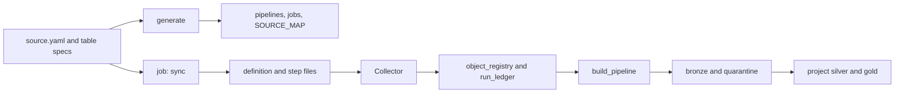
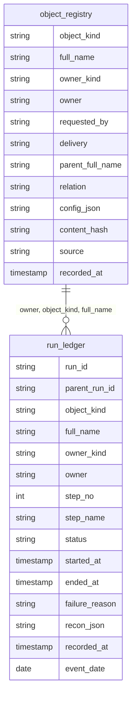
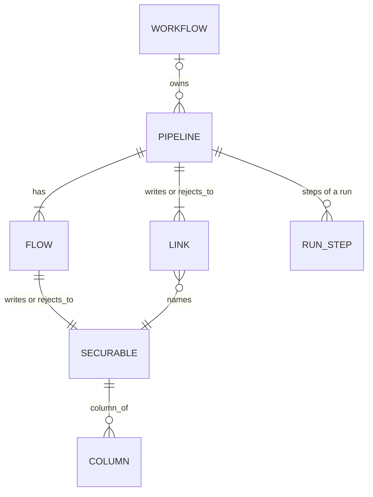
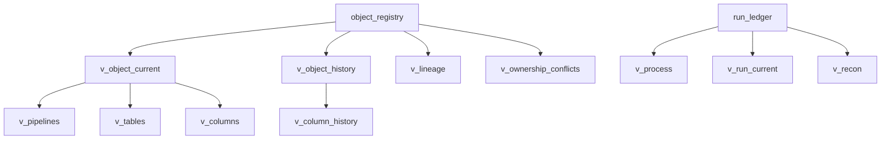

# Architecture

## The repository this replaces

`JLLT-EDP-Ingestion-develop.zip` is about 445 entries. It has 39 `setup.py` files and 32 directories under `eif_readers/`. `plugin_discovery.py` is 864 lines and mixes entry points, a filesystem scan, and `sys.path` changes. The same dataclass template is copied in `eif_config_manager/templates/`, `eif_utils/ingestion/templates/`, and `ingestion/templates/`. There is no declarative pipeline, no bronze or quarantine layer, and no metadata tables.

The Auto Loader format checks and option map are kept: format allow-list, a positive `max_files_per_trigger`, a required CSV delimiter, Excel `header_rows` of 0 or 1, a required Excel `data_address`, Excel schema evolution left off, and the `cloudFiles` options for format, existing files, type inference, overwrites, file and byte limits, rescue on permissive text, header, delimiter, and path glob. Checkpoint path and `cloudFiles.schemaLocation` are not kept.

## Layout

Folders at the repository root start with `framework_`. Four are bundles or hold bundles.

- `framework_src` is the wheel. Public names are `build_pipeline`, `validate_configs`, and `LoadMethod`.
- `framework_sql` is the registry DDL.
- `framework_bundle` is the platform bundle: the DDL job, the collector, and daily `OPTIMIZE`.
- `framework_ingestion` is the ingestion bundle: source systems, their table specs, and the pipelines and jobs generated from them.
- `framework_projects/<domain>/<project>` is one bundle per project for silver and gold.
- `framework_examples/consumer` is the original single-bundle example. It uses the `cloud_files` shape and is reference only.
- `framework_tests` runs without Spark.
- `framework_docs` is this documentation.

Three things are kept apart on purpose: the **meta framework** (registry and collector), **source ingestion** (domain-owned, shared), and **projects** (silver and gold, one owner each). They deploy separately and have different owners.

## Dependency direction

Each module imports only the ones listed:

- `config` imports nothing from the package. It validates specs and joins a spec with its `source.yaml`.
- `load` and `quality` import `config`.
- `pipeline` imports `config`, `load`, and `quality`.
- `metadata` imports `config` and `quality`.
- `collector` imports `metadata` and `pipeline`.
- `ingestion` imports `config`. `projects` imports `config` and `ingestion`.
- `cli` imports all of them.

`pipeline` calls `config`, `quality`, `load`, and a metadata reader passed in. Load strategies return option dictionaries and SQL strings. They do not import `pyspark` or `pipelines`. `build_pipeline` touches Spark and `pyspark.pipelines` only when the caller passes nothing, which is the generated one-line pipeline file on a cluster. `ingestion` and `projects` read YAML and write files. The CLI validates and writes files without a session.

## Registry, physical

History is insert-only. A version is `(object_kind, full_name, recorded_at)`. A run step is `(run_id, step_no, status)`. The tables do not declare those as primary keys. A run matches the definition that was active when `owner`, `object_kind`, and `full_name` are equal and `started_at` is inside `[valid_from, valid_to)`.

`object_registry` is clustered by `(owner, object_kind, full_name, recorded_at)`. `run_ledger` is clustered by `(owner, event_date, full_name, run_id)`.

## Registry, logical

Every box is a row in `object_registry`, except `RUN_STEP`, which is a row in `run_ledger`. `parent_full_name` and `relation` are the edges.

| Kind | `full_name` | Parent | `relation` | What `config_json` holds |
| --- | --- | --- | --- | --- |
| `workflow` | `job_name` | none | none | `pipeline_id` |
| `pipeline` | `pipeline_id` | `job_name` when set | `owns` | Canonical spec and compiled rules |
| `flow` | `<pipeline_id>.raw`, `.bronze`, `.quarantine` (no `.raw` without a raw table) | pipeline | `writes` or `rejects_to` | Table name and layer |
| `streaming_table`, `table`, `materialized_view` | `<catalog>.<schema>.<table>` | the flow name | `writes` or `rejects_to` | Layer, domain, classification, PII |
| `link` | `<pipeline_id>-><table>` | pipeline | `writes` or `rejects_to` | Child table name |
| `column` | `<table>.<column>` | table name | `column_of` | Ordinal, type, description, classification, PII |

Every row carries `owner_kind`, `owner`, `requested_by`, and `delivery`. A raw table is a `streaming_table` for Auto Loader and a `table` for COPY INTO and CTAS. Bronze and quarantine are a `materialized_view` for CTAS and for a database `snapshot`, and a `streaming_table` otherwise. Bronze written by Auto CDC (dedup, or database `merge`) stays a `streaming_table`.

Each object is hashed on its own document, so a job rename versions the pipeline and the workflow but not a table or column whose own fields did not change. A column hash covers ordinal, data type, description, classification, and PII. The column name is the key, so a rename is a different column. Columns are recorded for every table the pipeline writes: raw (with `_source_file` and `_ingested_at`), bronze, and quarantine (with `failed_rules`). Without a raw table, bronze and quarantine carry the lineage columns the pipeline adds.

## Views

Views do not store a second copy. Current views keep the latest row. History views add `valid_from` (`recorded_at`) and `valid_to` (the next `recorded_at` for that object, or null).

`v_lineage` is the latest `link` row for each parent, child, and relation. `v_pipelines`, `v_tables`, and `v_columns` read `v_object_current` and extract fields from `config_json`. `v_column_history` is `v_object_history` where `object_kind` is `column`. `v_recon` is the `record_success` step with `recon_json` parsed. `v_run_current` is the latest step in the last 7 days. `v_ownership_conflicts` lists any name with more than one owner.

## Design choices

**Source drives the pipeline.** The kind of source decides the graph. Files stay in a raw volume and bronze reads them from there. Databases are read through a foreign catalog straight into bronze. Only the original `cloud_files` path has a raw table. Quarantine and bronze are always built, and both are filtered by the quality rules.

**Facts live once.** The source's kind, raw volume, and foreign catalog are in `source.yaml`. A table spec holds only the table. `compose_document` joins them, so a new table cannot disagree with its source.

**Ownership is explicit.** Bronze is owned by the source system, because a source system is shared by many teams. Silver and gold are owned by a project. The registry stores `owner_kind` and `owner` on every row, plus `requested_by` for bronze. The collector enforces one owner per table.

**A delivery is the unit of deployment.** Every table in a delivery loads in one pipeline and one job. A new table in an existing delivery is a spec file and nothing else.

**Everything operational is generated from the specs.** Pipelines, jobs, and maps come from one model, so the map is the deployed state. Generated files are marked, deleted when unneeded, and checked in CI.

**Load methods are strategies** with one contract: name, supported formats, the raw relation, options, and batch SQL. The pipeline template reads the strategy. It does not subclass a reader hierarchy.

**Quality rules are functions from config to SQL.** The template does not know how a not-null rule was produced.

**The registry is two tables** because the old procedures used a system, a stream, a job, an object, two attribute tables, a relationship table, and several logs. Attributes and relationships are columns. Run steps, failure text, and reconciliation are rows in `run_ledger`.

Lakeflow Connect is how SharePoint, and later other managed sources, will reach the raw volume or bronze. See the [roadmap](ROADMAP.md).

## Migration

Keep, rewritten small: the Auto Loader checks and option map above.

Retire: the 39 per-handler packages, entry-point discovery, and the copied dataclass templates.

Do not copy into this package: the writers, the API handlers, the batchfile deploy tooling, or the `sys.path` changes.

## Behaviour that still needs a workspace

See the list in [END_TO_END.md](END_TO_END.md). Where the code assumes a syntax, the module states the assumption by using the current Lakeflow form, and the docs list the check.
