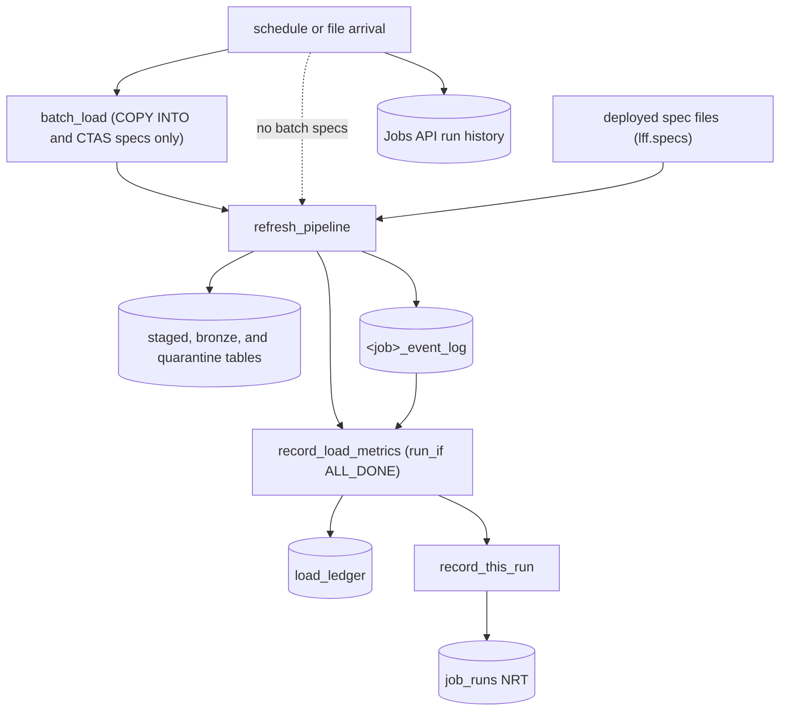
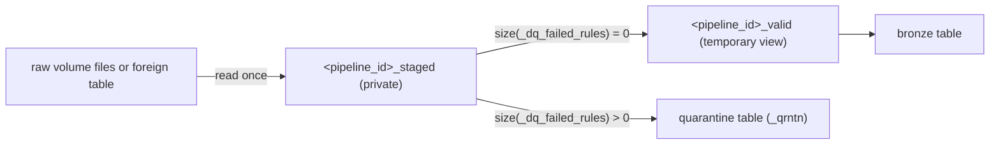
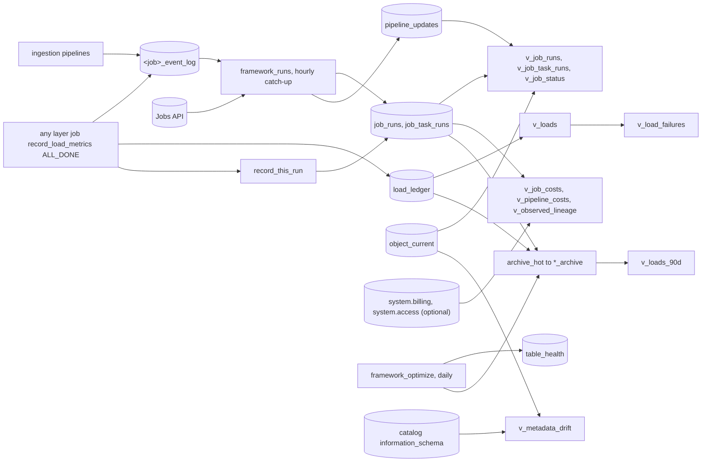
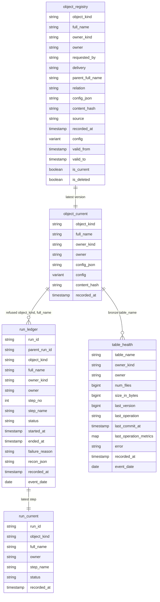
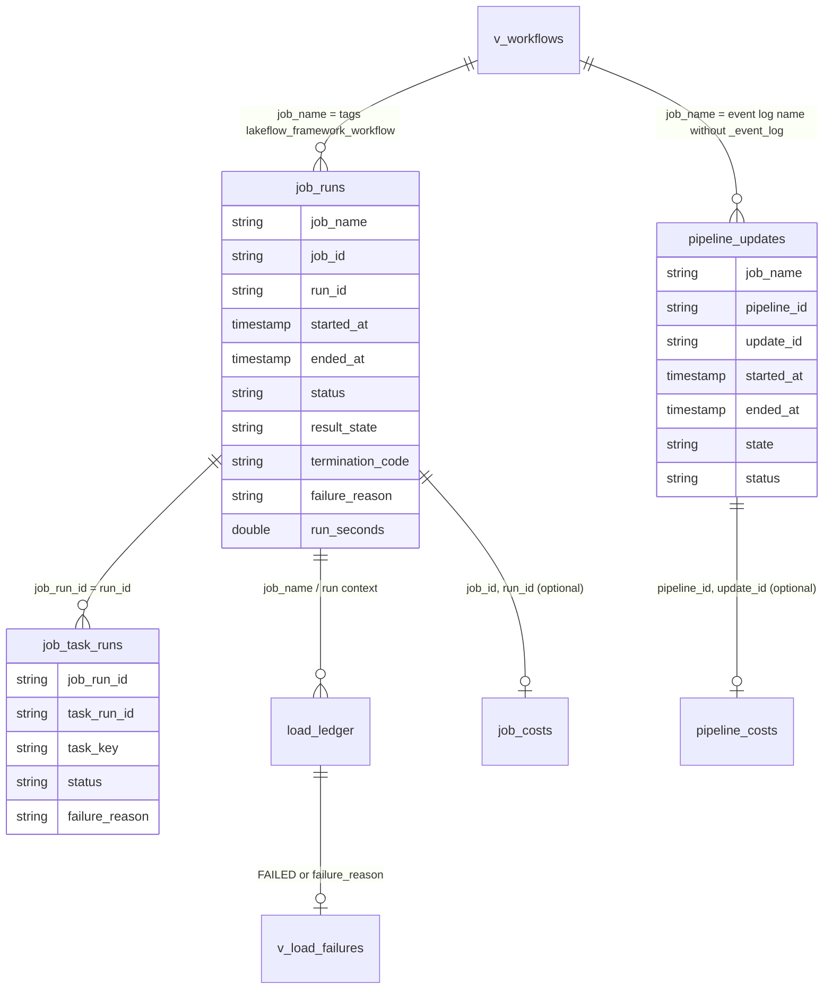
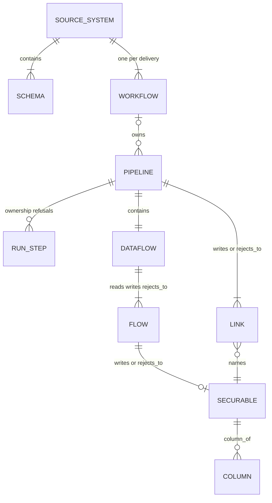
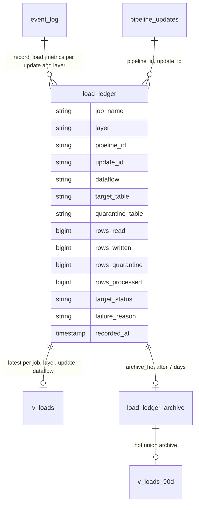

# Architecture

How the framework is put together: the folders, the code, every table it writes, and how data and metadata move between them. The run path step by step is in [END_TO_END.md](END_TO_END.md); the YAML contracts are in [README.md](README.md).

## Layout

Folders at the repository root start with `framework_`.

- `framework_lff_lib` is the wheel. Public names are `build_pipeline`, `validate_configs`, and `LoadMethod`.
- `framework_bundle` deploys that wheel and the metadata registry: `sql/framework_meta.sql` and `sql/system_views.sql`, the DDL jobs, the hourly `framework_runs` job (job runs and pipeline updates), and the daily `framework_optimize` job (compaction, archive of hot metrics older than 7 days, and table health).
- `framework_ingestion` is source to bronze: source systems, table specs, and the pipelines and jobs generated from them.
- `framework_curation/<domain>/<project>` is one bundle per project for silver, gold, and data products.
- `framework_examples/ingestion` is the set of specs to copy for each source kind. `framework_examples/consumer` is the original single-bundle example and is reference only.
- `framework_tests` holds package tests. They copy sample YAML and use fake Spark objects; they do not start a cluster.
- `framework_docs` is this documentation.

Three things are kept apart on purpose: the **meta framework** (registry and metrics), **source ingestion** (domain-owned, shared), and **curation** (silver, gold, and data products, one project owner each). They deploy separately and have different owners.

## Modules

Each module imports only the ones listed:

| Module | Imports | What it does |
| --- | --- | --- |
| `config` | nothing | Validates specs, joins a spec with its `source.yaml`, and holds `PipelineConfig` |
| `load` | `config` | Load strategies: Auto Loader options, `schemaHints`, and batch SQL. No `pyspark` |
| `quality` | `config`, `load` | Rules to SQL predicates, `_dq_failed_rules`, and the warn expectations |
| `pipeline` | `config`, `load`, `quality` | `assemble` builds the dataset graph; `build_pipelines` reads the specs in `lff.specs` and registers the graph with `pyspark.pipelines` |
| `metadata` | `config`, `quality` | Registry rows, step payloads for ownership refusals, and the registry SQL lookups |
| `registry` | `metadata` | The only registry writer: definitions with the ownership check, and the DDL |
| `unity` | nothing | Applies schema, table, and column tags and column comments to Unity Catalog |
| `health` | nothing | Records `DESCRIBE DETAIL` and `DESCRIBE HISTORY` figures per bronze table |
| `runs` | nothing | Records job runs from the Jobs API and pipeline updates from the event logs |
| `ingestion` | `config`, `metadata`, `unity` | Reads `source.yaml` and specs, generates pipelines, jobs, and `SOURCE_MAP.md`, and builds the deploy's registry rows |
| `projects` | `config`, `ingestion` | Validates `project.yaml` and writes the project maps |
| `cli` | all of them, most on first use | `lakeflow-framework` commands, called by `run.sh` and the job tasks |

Load strategies return option dictionaries and SQL strings. `build_pipeline` touches Spark and `pyspark.pipelines` only when the caller passes nothing, which is the generated one-line pipeline file on a cluster. The CLI validates and writes files without a session.

## Flows

### From a spec to deployed resources

One delivery of one source system is one pipeline and one job, named `<source_system>_<delivery>`. `framework_bundle` deploys first and runs `framework_ddl`, then `framework_system_views`, which does nothing unless the target sets `system_views` to `true`. `framework_ingestion` deploys next and runs `registry_sync`, the only writer of definitions. At every deploy it:

1. Writes every source system, schema, workflow, pipeline, dataflow, flow, table, link, and column the bundle defines. A new or changed definition gets a new version in `object_registry`, and the version it replaces is closed.
2. Retires what the bundle no longer defines. Each such object gets a deletion version and leaves `object_current`.
3. Sets the tags on each schema, table, and column, and each column comment, in Unity Catalog. It changes only what differs.

`run.sh deploy` fails when `registry_sync` fails, so a deploy whose metadata did not load is a failed deploy. The generated job also carries tags: the `lakeflow_framework_workflow` tag the run views join on, and the source's `domain`, `owner`, `owner_email`, `source_kind`, `delivery`, `requested_by`, and `data_domain`.

### A delivery run

The job runs **refresh_pipeline**, then **record_load_metrics** with `run_if: ALL_DONE` (even when the pipeline failed), which appends that update's counts into the central `load_ledger` with the job's medallion `layer`, or a **FAILED stub** when the event log has no `flow_progress`. Then **record_this_run** writes NRT status and `failure_reason` into `job_runs`. Insert only; no MERGE; no scan of target tables. Frozen `cloud_files` methods add **batch_load** before the refresh. The pipeline validates its deployed spec files itself, so a run neither writes nor waits on the registry. Hourly `framework_runs` is catch-up from the Jobs API and event logs.

### Inside one pipeline: source to bronze and quarantine

The staging table computes `_dq_failed_rules` once per row and carries one warn expectation per rule, so pass and fail counts reach the event log. Bronze is an append streaming table, an Auto CDC streaming table (`dedup: true`, or database `merge`), or a materialized view (database `snapshot`). The frozen `cloud_files` methods add a raw table before the staging table.

### Metrics and governance

## Data model

Editable Lucidchart (tabs: ERD, **framework_meta catalog**, **Team process: patterns → jobs**): [Lakeflow framework_meta](https://lucid.app/lucidchart/4713f75e-9ce7-407b-a31c-5444a17b9ec9/edit). Purpose and usage of every table and view: [framework_meta_data_dictionary.html](framework_meta_data_dictionary.html) (open in a browser; use **Download HTML** for an offline copy).

### Every table, by owner

| Table | Schema | Written by | Grain | Kind |
| --- | --- | --- | --- | --- |
| `object_registry` | `framework_meta` | `registry_sync` | One version of one definition | Delta, SCD Type 2 |
| `object_current` | `framework_meta` | `registry_sync` | One row per `(object_kind, full_name)` | Delta, merged |
| `run_ledger` | `framework_meta` | `registry_sync` | One ownership refusal, or a job step from before steps moved to the system tables | Delta, insert-only |
| `run_current` | `framework_meta` | `registry_sync` | One row per `(owner_kind, owner, object_kind, full_name)` | Delta, merged |
| `table_health` | `framework_meta` | `framework_optimize` | One bronze table per day | Delta, append |
| `job_runs` | `framework_meta` | each job (`record_this_run`) + hourly `framework_runs` | One run of a framework job | Delta, merged on `(job_id, run_id)` |
| `job_task_runs` | `framework_meta` | `framework_runs` (+ NRT when available) | One task run of a job run | Delta, merged on `(job_run_id, task_run_id)` |
| `pipeline_updates` | `framework_meta` | `framework_runs` | One update of an ingestion pipeline | Delta, merged on `(pipeline_id, update_id)` |
| `load_ledger` | `framework_meta` | each job (`record_load_metrics`) | One job, layer, update, and dataflow (incl. FAILED stubs) | Delta, insert-only, ~7-day hot |
| `load_ledger_archive` / `job_runs_archive` / `job_task_runs_archive` / `pipeline_updates_archive` | `framework_meta` | `framework_optimize` `archive_hot` | Rows moved off hot after 7 days | Delta, forever |
| `load_daily_rollup` | `framework_meta` | reserved for daily rollup refresh | One job/layer/day aggregate | Delta |
| `ddl_applied` | `framework_meta` | `framework_ddl` / `apply_ddl` | One SQL file hash per successful apply | Delta, insert-only |
| `<job>_event_log` | `framework_meta` | each ingestion pipeline | One pipeline event | Event log table |
| `flow_events` / `table_load_metrics` | `framework_meta` | deprecated (DDL kept; not written by ops) | Legacy dual-path metrics | Streaming table / MV |
| `<pipeline_id>_staged` | none (private) | ingestion pipeline | One source row | Private streaming table or materialized view |
| bronze, `<schema>.<table>` | `<source>_bronze` | ingestion pipeline | One passing row, or one row per key with Auto CDC | Streaming table or materialized view |
| quarantine, `<table>_qrntn` | `<source>_bronze` | ingestion pipeline | One failing row | Streaming table or materialized view |

The registry tables change once per deploy, `table_health` and hot→archive once a day, and hourly `framework_runs` is catch-up. A delivery or curation run writes its own data tables, event log, one append into `load_ledger` for its layer, and NRT `job_runs` via `record_this_run`. The framework creates nothing outside `framework_meta` except the tables its pipelines publish. Schemas, volumes, and foreign catalogs exist before a deploy. The `framework_events` volume that older versions created is no longer used; drop it by hand once nothing reads it. Until go-live, drop `framework_meta` to pick up new columns (`failure_reason`, archives); `CREATE IF NOT EXISTS` will not ALTER existing tables.

### Registry, physical

`object_registry` is SCD Type 2 on `(object_kind, full_name)`. Each version has `valid_from`, `valid_to`, `is_current`, and `is_deleted`. A definition has exactly one current version. When a deploy changes it, one `MERGE` sets the old version's `valid_to` and `is_current = false` and inserts the new one, so a retried deploy cannot leave the history half written. When a deploy no longer defines it, the current version is closed and a deletion version (`is_deleted = true`) becomes current. If the definition comes back, the deletion version is closed in turn. Rows are never deleted, and only `valid_to` and `is_current` are ever updated. `run_ledger` and `table_health` are events and stay insert-only. A version is `(object_kind, full_name, valid_from)`. A ledger step is `(run_id, step_no, status)`; an ownership refusal has `run_id = ownership-<first 16 characters of the hash>` and `step_name = ownership_check`. The tables do not declare those as primary keys. The definition active at time `t` is the version with `valid_from <= t` and `valid_to` null or later, in `v_object_history`.

`object_current` has every column of `object_registry` except the four SCD columns: it is the current, non-deleted version of each definition. `run_current` has every column of `run_ledger`. The diagram shows the keys and the columns most queries use.

| Table | Clustered by |
| --- | --- |
| `object_registry` | `(owner, object_kind, full_name)` |
| `object_current` | `(owner, object_kind, full_name)` |
| `run_ledger` | `(owner, event_date, run_id)` |
| `run_current` | `(owner, object_kind, full_name)` |
| `table_health` | `(owner, event_date, table_name)` |

Every registry table sets `delta.autoOptimize.optimizeWrite` and `delta.autoOptimize.autoCompact`; `table_health` sets `optimizeWrite`.

`config` is `config_json` parsed to `VARIANT`; `content_hash` is computed over `config_json`, so both are kept. In `run_ledger` and `run_current`, `parent_run_id`, `step_no`, `started_at`, and `ended_at` are only set on job steps from before runs moved to the system tables, and `recon_json` is no longer written. The columns stay so those rows still read.

### Runs, from the Jobs API and the event logs

Run outcomes do not need the system tables. `framework_runs` copies them hourly:

- **Job runs.** The `job_runs` task lists the workspace's jobs through the Jobs API and keeps those whose `lakeflow_framework_workflow` tag names a registered workflow. It lists their runs with tasks from two days before the latest recorded start, or 30 days back on the first pass, and reads again any run still `RUNNING`. Rows are merged on their keys, so a run is updated when it ends. `status` is `RUNNING`, `SUCCEEDED`, `SKIPPED`, or `FAILED`. The identity that runs the job needs `CAN_VIEW` on the delivery jobs, which the deploying identity has.
- **Pipeline updates.** The `pipeline_updates` task reads the `update_progress` events in every `<job>_event_log`. An update with an event in the window is read whole. `state` is the last update state, and `status` is `SUCCEEDED`, `FAILED`, `CANCELED`, or `RUNNING`.
- **Cost, optional.** `system_views.sql` joins `job_runs` and `pipeline_updates` to `system.billing.usage` and `list_prices` as `v_job_costs` and `v_pipeline_costs`. It needs `SELECT` on `system.billing` and runs only when the target sets `system_views` to `true`. `v_observed_lineage` there needs `system.access`.

A run that started and ended between two passes is still listed: the window starts before the latest recorded start. Runs older than the Jobs API keeps (60 days) are only in `job_runs` if `framework_runs` saw them in time.

### Registry, logical

Every box is a row in `object_registry`, except `RUN_STEP`, which is an ownership refusal in `run_ledger`. `parent_full_name` and `relation` are the edges.

| Kind | `full_name` | Parent | `relation` | What `config` holds |
| --- | --- | --- | --- | --- |
| `source_system` | source system name | none | none | `source.yaml`: domain, owner email, source kind, engine, foreign catalog, raw volume, and each delivery with its schedule or trigger and job name |
| `schema` | `<catalog>.<schema>` | the source system | `contains` | The layers the source writes there, and the tags `registry_sync` sets on the schema |
| `workflow` | `job_name` | none | none | Every `pipeline_id` in that job, every requester, the source system and kind, and the delivery's schedule or trigger |
| `pipeline` | `pipeline_id` | `job_name` when set | `owns` | Canonical spec and compiled rules |
| `dataflow` | `pipeline_id` | the pipeline | `contains` | Raw layer, bronze table, and quarantine table |
| `flow` | `<pipeline_id>.raw`, `.bronze`, `.quarantine` | the dataflow | `reads`, `writes`, or `rejects_to` | Volume path, or table name and layer |
| `streaming_table`, `table`, `materialized_view` | `<catalog>.<schema>.<table>` | the flow name | `writes` or `rejects_to` | Layer, domain, data domain, team, technical owner, classification, PII, `pipeline_id`, job name, and load method |
| `link` | `<pipeline_id>-><table>` | pipeline | `writes` or `rejects_to` | Child table name |
| `column` | `<table>.<column>` | table name | `column_of` | Ordinal, type, description, classification, PII |
| `run_ledger` step | the refused pipeline or table | none | none | `ownership_check`, `FAILED`, and the holder in `failure_reason` |

A file source whose raw layer is a volume still has a `raw` flow. That flow records the volume path and has no securable. A `cloud_files` raw flow has a securable, because its raw layer is a Delta table. A database load has no raw flow. Every row carries `owner_kind`, `owner`, `requested_by`, and `delivery`. A raw table is a `streaming_table` for Auto Loader and a `table` for COPY INTO and CTAS. Bronze and quarantine are a `materialized_view` for CTAS and for a database `snapshot`, and a `streaming_table` otherwise. Bronze written by Auto CDC (dedup, or database `merge`) stays a `streaming_table`.

Each object is hashed on its own document. A job rename versions the workflow, the pipeline, and its tables, because the job name is a table tag. It does not version a column whose own fields did not change. A column hash covers ordinal, data type, description, classification, and PII. The column name is the key, so a rename is a different column.

### Data tables

What each table the pipeline writes holds, beyond the spec's `columns`:

| Table | Extra columns | Rows |
| --- | --- | --- |
| `<pipeline_id>_staged` | `_source_file` and `_ingested_at` (volume files), `_ingested_at` (database), `_rescued_data` (Auto Loader on CSV, delimited, JSON, text), `_dq_failed_rules` | Every source row |
| bronze | The same lineage columns, without `_dq_failed_rules` | Rows with no failed rule; with Auto CDC, the latest row per key by the watermark |
| quarantine | The same lineage columns and `failed_rules` | Rows with at least one failed rule |

Every published table gets a comment, `table_properties` (`quality` = its layer, and `lakeflow_framework.pipeline_id`), and liquid clustering. At deploy, `registry_sync` sets these Unity Catalog tags:

| On | Tags | From |
| --- | --- | --- |
| each schema the source uses | `domain`, `owner` (the source system), `owner_email`, `source_kind`, `layer`, `foreign_catalog`, `engine` | `source.yaml`, and the layers its specs write there |
| each table | `classification`, `domain`, `pii`, `data_domain`, `team`, `technical_owner`, `layer`, `pipeline_id`, `job_name`, `load_method`, `owner`, `requested_by`, `delivery` | the table spec, joined with `source.yaml` |
| each column | `classification`, `pii`, and `description` as the comment | the spec's `columns` |

A tag with no value is not set, and one the spec no longer gives is unset. Tags the framework does not own are left alone. A value is trimmed and cut to 255 characters, within the Unity Catalog limit. A schema or table that does not exist yet is skipped and tagged at the next deploy.

### Metrics, physical

`job_name` comes from the event log's table name, `<job>_event_log`. `pipeline_id` is the Databricks pipeline id, which joins to `v_pipeline_updates` with `update_id`. `dataflow` is the spec's `pipeline_id`, which joins to the registry. Rule counts land on the ledger from staged `flow_progress` when present.

**Per-load counts.** `v_loads` (or `load_ledger`) is the sole recon SoR for bronze, silver, gold, and product. Counts come from that update's event log in the job itself (`ALL_DONE`), with FAILED stubs when there is no progress; never MERGE. Filter on `layer` for one medallion layer. `v_bronze_loads` is the bronze slice with legacy column aliases. `v_loads_90d` unions 7-day hot with forever archive for dashboards. `v_load_failures` joins loads to job/task `failure_reason` for repair. Legacy `flow_events` / `table_load_metrics` DDL may remain but are not written by the ops bundle.

## Views

```mermaid
flowchart TD
  object_registry --> v_object_history
  object_current --> v_object_current
  v_object_current --> v_source_systems
  v_object_current --> v_schemas
  object_current --> v_lineage
  object_current --> v_ownership_conflicts
  object_current --> v_bronze_tables
  object_current --> v_metadata_drift
  information_schema[catalog information_schema] --> v_metadata_drift
  v_object_current --> v_workflows
  v_object_current --> v_pipelines
  v_object_current --> v_dataflows
  v_object_current --> v_flows
  v_object_current --> v_tables
  v_object_current --> v_columns
  v_object_history --> v_column_history
  run_ledger --> v_process
  run_ledger --> v_ownership_refusals
  run_current --> v_run_current
  v_workflows --> v_job_status
  v_job_runs --> v_job_status
  v_workflows --> v_job_runs
  job_runs --> v_job_runs
  job_task_runs --> v_job_task_runs
  pipeline_updates --> v_pipeline_updates
  v_workflows --> v_pipeline_updates
  load_ledger --> v_loads
  v_loads --> v_bronze_loads
  load_ledger --> v_loads_90d
  load_ledger_archive --> v_loads_90d
  v_loads --> v_load_failures
  v_job_runs --> v_load_failures
  v_job_task_runs --> v_load_failures
  v_job_runs --> v_job_costs
  v_pipeline_updates --> v_pipeline_costs
  object_current --> v_observed_lineage
  system_tables["system.billing, system.access (optional)"] --> v_job_costs
  system_tables --> v_pipeline_costs
  system_tables --> v_observed_lineage
```

`framework_meta.sql` creates every view except three; `system_views.sql` creates `v_job_costs`, `v_pipeline_costs`, and `v_observed_lineage`, in their own job because they need system table grants. That job runs them only when the target sets `system_views` to `true`. The views read fields from `config` with `config:path`. `v_job_status` is each workflow and its latest run from `v_job_runs`. `v_ownership_refusals` lists every definition `registry_sync` refused, and `v_run_current` the latest ledger step per object. `v_loads` keeps the latest `load_ledger` row per job, layer, update, and dataflow (retries of `record_load_metrics` may append again). `v_loads_90d` unions hot and archive; `v_load_failures` surfaces what failed and why.

`v_object_history` reads the SCD columns from `object_registry`; it does not window. Filter `owner`, the first clustering key, to read less. `object_current` is keyed by `object_kind` and `full_name`: a pipeline or table has one current row. `v_source_systems` and `v_schemas` list the current source systems and the schemas they use, with their tags. `v_metadata_drift` covers schema, table, and column tags, with `securable` saying which.

How the views join their sources:

| View | Joined on |
| --- | --- |
| `v_job_runs`, `v_job_task_runs` | `job_runs.job_name` (the job's `lakeflow_framework_workflow` tag) = `v_workflows.job_name` |
| `v_pipeline_updates` | `pipeline_updates.job_name` (the event log's name) = `v_workflows.job_name` |
| `v_loads` | `load_ledger` partitioned by `job_name`, `layer`, `update_id`, `dataflow`; latest `recorded_at` |
| `v_loads_90d` | hot `load_ledger` union `load_ledger_archive` (QUALIFY latest) |
| `v_load_failures` | loads + job/task runs where status FAILED or `failure_reason` set |
| `v_bronze_loads` | `v_loads` where `layer = 'bronze'` (legacy column aliases) |
| `v_job_costs` | `system.billing.usage` `usage_metadata.job_id` and `job_run_id` = `job_runs.job_id` and `run_id` |
| `v_pipeline_costs` | `usage_metadata.dlt_pipeline_id` and `dlt_update_id` = `pipeline_updates.pipeline_id` and `update_id` |
| `v_observed_lineage` | `table_lineage.target_table_full_name` = the dataflow's bronze or quarantine table |
| `v_metadata_drift` | `information_schema` schema, table, and column names = the registry names, lower-cased |

## Design choices

**The Unity Catalog volume is the raw layer for file kinds.** `sftp_files` and `sharepoint_files` keep the files as delivered and have no raw Delta table. A database has no raw layer. `cloud_files` writes a raw table first. Its path may be `abfss://`, `s3://`, or a `/Volumes/<catalog>/<schema>/<volume>` path. Quarantine and bronze are always built, and both are filtered by the quality rules.

**The source system owns bronze.** Many teams can add specs under one source. The registry records `requested_by` for the team that asked. `registry_sync` refuses a second source system for the same table. Silver, gold, and data products are owned by a project.

**A delivery is the pipeline.** Every table in a delivery loads in one Lakeflow pipeline and one job. A second schedule is a second delivery in that source's `source.yaml`. A new table in an existing delivery is a spec file and nothing else. Cross-table waits belong to curation, not to bronze.

**Each source is read once.** A pipeline cannot send one read to two tables, and a temporary view runs again for every reader, so a private staging table holds the one read. Bronze holds only clean rows; quarantine keeps the failing rows with `failed_rules`.

**Facts live once.** The source's kind, raw volume, and foreign catalog are in `source.yaml`. A table spec holds only the table. `compose_document` joins them, so a new table cannot disagree with its source.

**Everything operational is generated from the specs.** Pipelines, jobs, and maps come from one model, so the map is the deployed state. Generated files are marked, deleted when unneeded, and checked in CI.

**Load methods are strategies** with one contract: name, supported formats, the raw relation, options, and batch SQL. The pipeline template reads the strategy. It does not subclass a reader hierarchy.

**Quality rules are functions from config to SQL.** The template does not know how a not-null rule was produced.

**The registry records intent; the platform records what happened.** Definitions and owners are in the registry, written once per deploy. Row counts and pipeline update states come from the event logs, job runs from the Jobs API, and, where the grants exist, cost from `system.billing` and observed lineage from `system.access`. The views join them.

**Nothing required reads a system table.** Grants on `system.*` are given by a metastore admin and are often not available to a delivery team. Run status works without them; only cost and observed lineage are optional extras.

**Unity Catalog holds the governance metadata.** The spec and `source.yaml` are the source; `registry_sync` writes them to Unity Catalog at every deploy and changes only what differs. `v_metadata_drift` shows anything that disagrees.

**Definitions are SCD Type 2; events are not.** A definition has a life: it is created, changed, and removed, and `object_registry` keeps every state with when it held. A refusal, a health reading, or a load-metrics append happens once, so `run_ledger`, `table_health`, and `load_ledger` only append.

**One bundle retires one owner kind.** `registry_sync` retires every `source_system`-owned object in the catalog that `framework_ingestion` no longer defines. That is right while `framework_ingestion` is the only bundle that registers source systems in a catalog. A second bundle that registers source systems into the same catalog, or two developers deploying different branches into one dev catalog, would retire each other's definitions.

**Auto Loader options are a fixed map.** A format allow-list, `max_files_per_trigger` (1000 when the spec omits it), JSON `multiline` only when the spec sets it, a required CSV delimiter, Excel `header_rows` of 0 or 1, and a required Excel `data_address`. The pipeline owns the checkpoint and `cloudFiles.schemaLocation`. CSV, delimited text, and JSON get `cloudFiles.schemaHints` from `columns`, and `source.file_events: true` sets `cloudFiles.useManagedFileEvents`.

Lakeflow Connect is how SharePoint, and later other managed sources, will reach the raw volume or bronze. See the [roadmap](ROADMAP.md).

## Behaviour that still needs a workspace

See the list in [END_TO_END.md](END_TO_END.md#checked-on-a-real-workspace).
