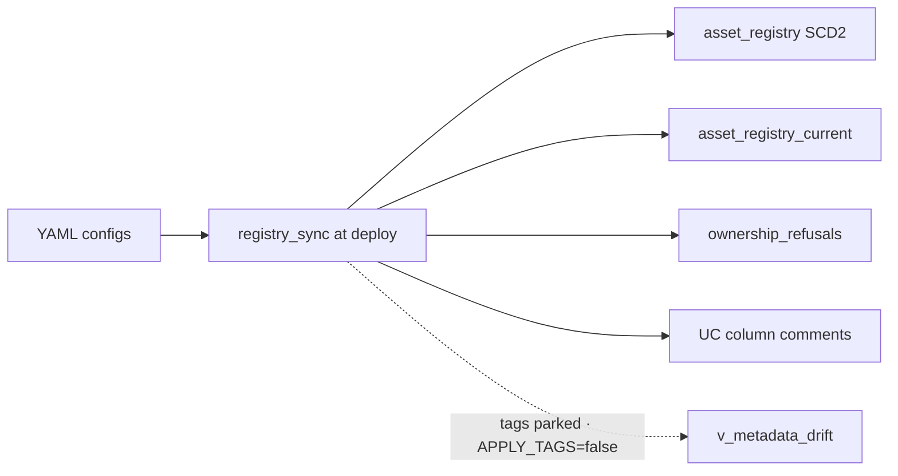

# YAML contracts

The repository overview is [../README.md](../README.md). This page is every file a team writes. Generated files are never edited.

| File | Who writes it | Where |
| --- | --- | --- |
| `source.yaml` | The source system's owner | `framework_ingestion/sources/<source_system>/` |
| `<source_system>_<table>.yaml` | The project bringing it in, or the source itself | `sources/<source_system>/<project>/`, or next to `source.yaml` when there is no project |
| `project.yaml` | The project | `framework_curation/<domain>/<project>/` |

Check them without a cluster: `./run.sh generate` for ingestion, `./run.sh projects:generate` for curation. Both print every error in one pass. Job runs, statuses, and definition metadata live in frozen `framework_meta` (see [META_MODEL_REVIEW.md](META_MODEL_REVIEW.md)); views are grouped by usage in the [root README](../README.md#query-views-by-usage).



Editable Lucid page: [7. Metadata via configs](https://lucid.app/lucidchart/4713f75e-9ce7-407b-a31c-5444a17b9ec9/edit?page=zl5NbFTVBczy#).

## source.yaml

One per source system. The kind, raw volume, and foreign catalog are set here once, and every table in the source inherits them.

```yaml
source_system: billing           # must equal the folder name
domain: finance                  # must equal the parent folder name
owner: billing.owner@jll.com
kind: sftp_files                 # sftp_files, sharepoint_files, database, or cloud_files
# Optional. When set, the generated job and pipeline run_as this principal.
# run_as: 00000000-0000-0000-0000-000000000000
# Optional. STANDARD or PERFORMANCE_OPTIMIZED (the default until go-live).
# performance_target: STANDARD

raw_volume:                      # file kinds: where files land as delivered
  schema: billing_raw
  volume: landing                # optional: the volume of a table that does not name source.volume

deliveries:
  daily:
    trigger: file_arrival        # fires when files land in the raw volume
  # or:  nightly: { schedule: "0 0 2 * * ?" }
```

| Field | Rule |
| --- | --- |
| `kind` | `sftp_files` and `sharepoint_files` need `raw_volume.schema`. `raw_volume.volume` is optional: each table can name its own `source.volume`, and one that does not uses this one. `database` needs `foreign_catalog` and takes an optional `engine` of `postgresql`, `azure_sql`, `sql_server`, or `db2`. `cloud_files` is the original raw-table path (frozen methods). |
| `run_as` | Optional service principal application id or name for the generated job and pipeline. |
| `performance_target` | Optional. `STANDARD` (cheaper) or `PERFORMANCE_OPTIMIZED` (faster cold starts). The default is `PERFORMANCE_OPTIMIZED` until go-live, then `STANDARD`. |
| `deliveries` | At least one. Each has exactly one of `schedule` (a Quartz cron) or `trigger: file_arrival`. A database delivery has a schedule only. A file-arrival trigger watches one volume, so every table in that delivery must read the same volume; give another volume its own delivery, or use a schedule. A `cloud_files` file-arrival delivery needs a path that starts with `abfss://` or `s3://`, or a `/Volumes/<catalog>/<schema>/<volume>` path. |
| `fetch` | Rejected. Copying files from SFTP or SharePoint into the raw volume is not built. |

A delivery is the unit of deployment: every table in it loads in one Lakeflow pipeline and one job. A source with different cadences has several deliveries.

## Table spec: a file table

For `sftp_files` and `sharepoint_files`. The spec holds only what is true of the table.

```yaml
pipeline_id: billing_invoices     # starts with the source system name; unique
domain: finance
data_domain: invoices
team: billing_squad
technical_owner: billing.owner@jll.com
layer: bronze
job_name: billing_daily           # optional; must equal <source_system>_<delivery>
delivery: daily                   # optional when the source has one delivery
requested_by: billing             # the team that asked for this table

notify:
  on_failure: [billing.owner@jll.com]
  on_success: [billing.owner@jll.com]

data:
  classification: confidential    # internal, confidential, or highly_confidential
  pii: [pii_finance, pii_personal]

source:
  # volume: landing               # a volume in the raw schema; default raw_volume.volume
  raw_path: invoices/             # a folder in the volume; omit it when the files sit at the top
  format: csv
  delimiter: ","
  header: true

raw_to_bronze:
  bronze: { schema: billing_bronze, table: invoices }
  dedup: true
  primary_keys: [invoice_id]
  watermark_column: updated_at
  columns:
    - name: invoice_id
      type: string
      description: Invoice identifier from the billing system
    - name: amount
      type: decimal(18,2)
      pii: [pii_finance]
    - name: updated_at            # dedup orders on it, so it must be a declared column
      type: timestamp
  rules:
    - name: amount_non_negative
      expression: amount >= 0

quarantine: { schema: billing_quarantine}
```

`source` also takes `path_glob`, `max_files_per_trigger` (default 1000), `multiline` (JSON only; default false), `header_rows` and `data_address` (Excel, both required), `external_location`, `file_events` (default false; set it only once file events are enabled on the volume's external location), and `expect_file` (every run must bring a file with rows; none, or an empty one, is recorded `FAILED` in the ledger while the job still succeeds. Default: true in a scheduled delivery, false in one fired by a file arriving).

`source.schema_evolution` says what happens when a file brings a column the table does not have. It applies to `csv`, `delimited` and `json`; another format refuses any value but `rescue`.

| Value | A new column in a file |
| --- | --- |
| `rescue` (default) | Its values go to `_rescued_data` and the row loads. The `new_columns` check only warns. |
| `add_new_columns` | It becomes a bronze column. The update stops once and the retry reads it. With declared `columns` it is added as text, and `generate` warns: declare it to give it a type. |
| `fail` | The update stops. The generated job's `park_failed_files` task moves the file to `_failed` (see [Quality rules](#quality-rules)). |
| `none` | It is ignored. |

`source.infer_schema` (`typed` or `strings`) is for a spec that declares no `columns` and reads `csv`, `delimited` or `json`. `typed` lets Auto Loader infer real types, `strings` keeps every column a string, and leaving it out behaves as `typed`. It belongs under `source`; under `raw_to_bronze` it is not read. It is refused when `columns` are declared. After the table's first load, the generated job's `infer_columns` task registers bronze's columns in the registry (marked `source = inferred`, for comments, tags and lineage only; they never change how files are read). It does one SELECT and stops once a table's columns are registered, and `registry_sync` keeps them on later deploys. A table with `schema_evolution: add_new_columns` gets an `infer_columns_refresh` task instead, which registers bronze's columns again after every run. To pick up columns by hand, run `framework_ingestion/src/infer_columns.py --catalog <catalog> --refresh <pipeline_id>`.

`_failed` and `_backfilled` at the top of a volume are reserved for parked and backfilled files: `source.raw_path` cannot reach into them. `raw_to_bronze.bronze.cluster_by` takes up to four columns; without it bronze uses automatic liquid clustering. Formats are `csv`, `delimited`, `text`, `json`, `parquet`, `avro`, `excel`. `fixed_width` and `yaml` are not supported from a raw volume yet. CSV and delimited files require `delimiter`. An Excel address may quote the sheet name, as in `'Sheet1'!A1`.

## Table spec: a database table

For `database`. Every table of a delivery loads in the same run.

```yaml
pipeline_id: erp_customers
domain: finance
data_domain: customers
team: erp_squad
technical_owner: erp.owner@jll.com
layer: bronze
delivery: nightly
requested_by: erp

data: { classification: confidential, pii: [pii_basic] }

source:
  table: dbo.customers            # <schema>.<table> in the source database
  mode: merge                     # snapshot (default) or merge

raw_to_bronze:
  bronze: { schema: erp_bronze, table: customers }
  primary_keys: [customer_id]     # required for merge
  columns:
    - { name: customer_id, type: string }

quarantine: { schema: erp_quarantine}
```

`snapshot` mirrors the source table on every run. With `primary_keys`, a row the source no longer has is kept and closed, not deleted. `merge` keeps bronze in step with the source on `primary_keys`, which it requires. `dedup` is not used for database tables, and `load_type` follows `source.mode` (`snapshot` is `full_refresh`, `merge` is `scd1`).

## Common spec rules

- `raw_to_bronze` holds the bronze table, keys, `columns`, and `rules`. Rows that fail the rules go to `<bronze table>_qrntn` in the bronze schema by default. The `quarantine` block is optional and can override `table`, `schema`, `classification`, `pii`, or `description`. A quarantine table exists only when the spec has `rules` or a `quarantine` block. With neither, no row is lost: a row failing the framework's own checks loads with a warning, and its unfit values go to `_rescued_data`. The one exception is a null key or sequence value in a table that applies changes by key (`scd1`, `scd2`, a database `merge`, or a database `snapshot` with `primary_keys`); that row is dropped and counted in `rows_dropped`.
- `raw_to_bronze.load_type` is how bronze takes rows: `append` (the default for files), `scd1` (upsert on `primary_keys`, ordered by `watermark_column`), `scd2` (keep every version), or `full_refresh` (database tables only). `dedup: true` is the older way to say `scd1`, and conflicts with `append`. `scd1` and `scd2` need `primary_keys` and a `watermark_column` that is a declared column.
- `raw_to_bronze.delete_when` is for `scd1` only: a SQL condition over the table's columns. A row it holds for is kept and flagged `_is_deleted = true`, never removed.
- A column is `name`, `type`, and an optional `description`, which becomes the column comment in Unity Catalog. The table's and each column's `classification` and `pii`, and the table's `domain`, `owner`, `data_domain`, `team`, `technical_owner`, layer, pipeline, job, load method, requester, and delivery, are the table's tags. The source's schemas get `source.yaml`'s domain, owner, owner email, kind, foreign catalog, and engine. `registry_sync` sets the column comments at deploy. Tags are not applied to Unity Catalog yet (`APPLY_TAGS = False` in `unity.py`). `classification` and `pii` on a column are only needed when they differ from the bronze table.
- A spec under `sources/` need not repeat what `source.yaml` and its folder say: `domain`, `layer`, `technical_owner` (the source owner), `delivery` (when the source has one), `job_name`, `requested_by` (the project folder), and `team` (the requester). A value in the spec wins.
- `description` becomes the table comment (at most 1024 characters). `spec_version` is `1`, the default. `extends: profiles/<name>` takes shared settings from a profile in [framework_ingestion/profiles](../framework_ingestion/profiles/README.md); the spec's own keys win. A `tables:` list puts several tables in one file: the shared settings on top, one short entry per table.
- `pii` values are `pii_health`, `pii_basic`, `pii_finance`, `pii_biometric`, `pii_personal`. Omit `pii` when there is none. A `raw`, `bronze`, or `quarantine` block can override `classification` or `pii`.
- `notify.on_failure` is who is mailed when the job fails. It defaults to the technical owner. The generated job's `email_notifications` carries the addresses of all its tables.
- Specs do not name a catalog. Every job passes the environment's catalog (`--catalog ${var.catalog}`), so one spec deploys to dev and prod. To validate by hand: `lakeflow-framework validate <folder> --catalog <catalog>`.
- Schemas default to `<source_system>_<layer>`. Do not put keys or passwords in a spec. Use a secret scope or a Unity Catalog connection.
- Older specs may say `project:` for the requesting team. It is read as `requested_by`. Specs under `sources/` must use `requested_by`.
- Two pipelines cannot write the same table, and `pipeline_id` is unique across the bundle.

## Quality rules

A rule is a `name` (an identifier, unique in the table) and an `expression`: boolean SQL over the table's columns. A null result counts as a failure. How to write one, and every check you can copy, is in [QUALITY_RULES.md](../framework_ingestion/QUALITY_RULES.md).

```yaml
raw_to_bronze:
  rules:
    - { name: amount_non_negative, expression: "amount >= 0" }
    - { name: currency_known, expression: "currency IN ('AUD', 'USD')", enabled: false }
  on_fail: quarantine             # quarantine (default), drop, warn, or fail
```

| Field | Rule |
| --- | --- |
| `on_fail` | What happens to a row that fails a rule. Set it once on `raw_to_bronze`, for every rule and the framework's own checks, or on each rule. A spec that sets both is refused. `raw_to_bronze.on_fail` needs `rules`. The old name `on_bad_rows` is refused. |
| `enabled` | Optional, default `true`. `false` keeps the rule in the spec and the registry (`v_rules` shows it with `enabled = false`), but it is never run. `check:rules` skips it. |

| `on_fail` | A failing row |
| --- | --- |
| `quarantine` | Goes to the quarantine table, with `failed_rules`. The good rows load. |
| `drop` | Is discarded and kept nowhere. Only the counts show it. |
| `warn` | Loads as usual. The failure is only counted. |
| `fail` | A file table: its whole file is blocked. No row of that file reaches bronze, its bad rows go to quarantine, and `ledger_detail` records the file `FAILED`. Other files load, then the update and the job fail. The job's `park_failed_files` task moves the file to `<volume>/_failed/<its path>`, which nothing reads. Fix it and reload it with `./run.sh backfill ... mode=failed`. A database table: the update fails and no row loads. |

The framework adds its own checks, which follow `raw_to_bronze.on_fail`: `not_null_<key>` for each primary key (and the watermark column of a `scd1` or `scd2` table), `cast_<column>` for each declared column, and `schema_conformance` for `csv`, `delimited`, `json` and `text` files. `new_columns` (with `schema_evolution: rescue`) only warns.

## Table spec: cloud files (original shape)

`cloud_files` keeps the first design: files land in a raw table, then bronze. It is not in the MVP: validation rejects `autoloader`, `copy_into`, and `ctas`, and the code is kept for later.

```yaml
source_to_raw:
  method: autoloader              # autoloader, copy_into, or ctas
  source:
    system: billing
    format: csv
    path: abfss://landing@storage.dfs.core.windows.net/billing/invoices/
    delimiter: ","
  raw: { schema: billing_raw, table: invoices }
raw_to_bronze: { ... as above ... }
quarantine: { ... as above ... }
```

Excel cannot use `copy_into`. `fixed_width` needs `fixed_columns` (`name`, `start`, `length`) on the source. A `cloud_files` path is `abfss://`, `s3://`, or `/Volumes/<catalog>/<schema>/<volume>/...`. `volume_files` is a volume path and does not create a raw table.

## project.yaml

```yaml
project: billing_reporting        # must equal the folder name
domain: finance
owner: reporting.owner@jll.com

silver:
  customer_orders:
    triggered_by: [erp.customers, erp.orders]        # bronze tables
    deadline: { at: "07:00", on_miss: alert }
gold:
  revenue_daily:
    triggered_by: [silver.invoices_clean, silver.customer_orders]
    reads: [headcount_reporting.silver.headcount_clean]
    deadline: { at: "08:00", on_miss: alert }
products:
  revenue:
    triggered_by: [gold.revenue_daily]
    deadline: { at: "09:00", on_miss: alert }
```

| Reference | Meaning |
| --- | --- |
| `<source_system>.<table>` | A bronze table in the ingestion bundle |
| `silver.<name>`, `gold.<name>`, `product.<name>` | A table or data product of this project |
| `<project>.silver.<name>`, `<project>.product.<name>` | A table of another project |

A table depends only on lower layers: bronze, then silver, then gold, then a data product. `triggered_by` is required and fires the job once every listed table has refreshed. `reads` is read without waiting. `deadline.on_miss` is `alert` or `run_stale`. A table with more than one `triggered_by` and no deadline is flagged on the map. The same layer and name cannot be created by two projects, and projects cannot depend on each other in a loop.

## Tables the pipeline writes

For source system `billing` and table `invoices`:

- Files from a raw volume or a database: `<catalog>.billing_bronze.invoices` and `<catalog>.billing_bronze.invoices_qrntn`. The quarantine table is the bronze table name plus `_qrntn`, in the bronze schema, unless the spec sets `quarantine.table` or `quarantine.schema`. It is created only for a spec with `rules` or a `quarantine` block.
- Cloud files also write `<catalog>.billing_raw.invoices`.

Quarantine carries `failed_rules`, the names of the rules that failed. Rows that pass go to bronze. Both are read from one private staging table, so the source is read once. Every row carries `_src_row_hash`, `_batch_id` (joins `load_ledger.batch_id`) and `_ingest_timestamp`. Volume-file rows also carry `_src_file_path` and `_src_file_name`, and `_rescued_data` for `csv`, `delimited`, `json` and `text`. A table with `delete_when` carries `_is_deleted`.

## Operations

The views are listed in the [root README](../README.md#query-views-by-usage). To reload files of a table, or refresh it, use the `framework_backfill` job (`./run.sh backfill`, in the [root README](../README.md#work-in-this-repo)). The full run path is in [END_TO_END.md](END_TO_END.md). The frozen metadata schema (NRT vs hourly catch-up, removed objects) is in [META_MODEL_REVIEW.md](META_MODEL_REVIEW.md).
