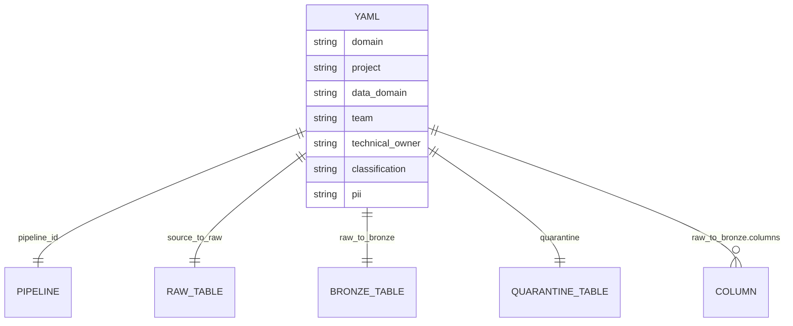

# Using the framework

The repository overview is [../README.md](../README.md). This page is the YAML contract. The physical registry is in [ARCHITECTURE.md](ARCHITECTURE.md).

One file describes one pipeline and the three tables it owns.



`notify` is mail on the job. It is stored on the pipeline document and copied onto `email_notifications`. It is not a table.

Supply one YAML file per pipeline and a one-line pipeline file. The bundle builds the wheel.

## Install

Declare the wheel as a bundle artifact and point each job or pipeline library at `dist/*.whl`. `databricks bundle deploy` builds that wheel and uploads it. The example bundle in this repo already does this. There is no volume copy and no PyPI publish.

## Pipeline file

```python
from lakeflow_framework import build_pipeline

build_pipeline("billing_invoices")
```

`build_pipeline` loads the current row from `<catalog>.framework_meta.v_object_current`. The pipeline id must match the YAML `pipeline_id`.

## YAML

A file is a bronze load. `layer` is `bronze`. Two hops are required.

`source_to_raw` lands files in `<system>_raw`. `method` is `autoloader` (default), `copy_into`, or `ctas`. The source `path` is `abfss://` or `s3://`.

`raw_to_bronze` publishes the raw table to `<system>_bronze`. Quality rules and column types sit on this hop. `dedup: true` requires `primary_keys` and `watermark_column`.

Each column is `name`, `type`, and an optional `description`. That description is the column comment stored in the registry. Add `classification` or `pii` on a column only when it differs from the bronze table. Omitted tags copy the bronze table tags. The allowed values are the same as `data.classification` and `data.pii`.

`quarantine` names the `<system>_quarantine` table that receives rows that fail those rules.

A domain holds many projects. The pipeline names that domain, the project, and the data domain. `technical_owner` is an email. `team` is the squad. `data.classification` is `internal`, `confidential`, or `highly_confidential`. `data.pii` lists `pii_health`, `pii_basic`, `pii_finance`, `pii_biometric`, or `pii_personal`. Omit `pii` when there is none. Put a different `classification` or `pii` on `raw`, `bronze`, or `quarantine` only when that table differs.

`notify.on_failure` lists who is mailed when the job fails. When it is left out, the technical owner is mailed. `notify.on_success` is optional. Copy those addresses into the job `email_notifications` block. The pipeline does not send mail.

```yaml
domain: finance
project: billing
data_domain: invoices
team: billing_squad
technical_owner: billing.owner@jll.com
layer: bronze
notify:
  on_failure:
    - billing.owner@jll.com
data:
  classification: confidential
  pii:
    - pii_finance
source_to_raw:
  method: autoloader
  source:
    system: billing
    format: csv
    path: abfss://landing@storage.dfs.core.windows.net/billing/invoices/
    delimiter: ","
  raw:
    schema: billing_raw
    table: invoices
raw_to_bronze:
  bronze:
    schema: billing_bronze
    table: invoices
  dedup: true
  primary_keys: [invoice_id]
  watermark_column: updated_at
  columns:
    - name: invoice_id
      type: string
      description: Invoice identifier from the source system
    - name: amount
      type: decimal(18,2)
      description: Invoice amount in the source currency
      pii:
        - pii_finance
  rules:
    - name: amount_non_negative
      expression: amount >= 0
quarantine:
  schema: billing_quarantine
  table: invoices
```

Excel cannot use `copy_into`. Fixed-width requires `fixed_columns` with `name`, `start`, and `length` on the source. CSV and delimited files require `delimiter`. `catalog` is a real catalog name. `${var.catalog}` left in the file is an error, so render the catalog before `lakeflow-framework validate`.

Silver and gold use the same `<system>_<layer>` schema name later. This package accepts `layer: bronze` only.

Do not put account keys, passwords, or tokens in the file. Point `external_location` at a Unity Catalog external location.

Sample tests for these configs are in [framework_examples/consumer/tests](../framework_examples/consumer/tests). Copy that file beside your own bronze YAML. It checks the raw and bronze names and the load SQL. It does not start a cluster.

## Validate

```bash
lakeflow-framework validate configs/
```

The command lists every error and does not start a cluster. Run it in CI.

## Tables

The three names for source system `billing` and table `invoices` are the tables in the diagram above:

- `<catalog>.billing_raw.invoices`
- `<catalog>.billing_bronze.invoices`
- `<catalog>.billing_quarantine.invoices`

Quarantine includes `failed_rules`. Rows that pass the rules land in bronze. A later silver or gold schema can use the same `<source_system>_<layer>` name. This package does not build those layers.

## Operations

Ask these views, with a `project` filter:

- `v_object_current` for pipelines, workflows, and securables
- `v_run_current` for the latest step
- `v_process` for one `run_id`
- `v_recon` for source and target counts
- `v_lineage` for links written by the pipeline
- `v_pipelines` for domain, project, data domain, team, owner, and mail
- `v_tables` for classification and PII on each table
- `v_object_history` for what was active at a point in time, for pipelines, workflows, flows, tables, and columns
- `v_columns` for the current type, description, classification, and PII of each column
- `v_column_history` for every version of those columns (`valid_from`, `valid_to`, `is_current`)

The example job in [framework_examples/consumer](../framework_examples/consumer) writes the step files, waits until the collector has loaded the definitions, and then refreshes the billing and ledger pipelines. A success step can carry counts with `--recon-json '{"source_count": 10, "output_rows": 9, "rejected": 1}'`.

The full path, including the collector and the registry layout, is in [END_TO_END.md](END_TO_END.md).
