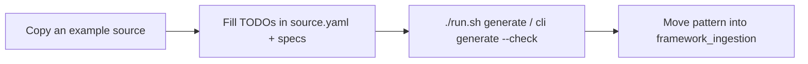

# Examples

[ingestion](ingestion/README.md) is the set of specs to copy. One source system per kind: `abs` (SFTP files in a raw volume, with and without a project), `policies` (SharePoint Excel), and `claims_db` (a database, snapshot and merge). `billing`, `erp`, and `hr_docs` hold the bronze tables the sample projects in [framework_curation](../framework_curation/README.md) read: `./run.sh projects:generate` checks the projects against these specs.

Platform flow and kinds: [Lucidchart](https://lucid.app/lucidchart/4713f75e-9ce7-407b-a31c-5444a17b9ec9/edit) · [root README](../README.md).

`consumer` is the original single-bundle example: YAML under `configs/bronze`, a one-line pipeline file under `pipelines`, and two hand-written jobs (`finance_ingest` and `example_loads`). It uses the `cloud_files` shape, where files land in a raw table first. Those methods are not in the MVP, so its tests and batch runner validate with `allow_frozen=True`.

It is kept as a reference and for its sample tests. Do not copy it for new work. New tables go in [framework_ingestion](../framework_ingestion/README.md), where pipelines and jobs are generated from the specs. Silver, gold, and data products go in [framework_curation](../framework_curation/README.md).

- It registers `billing_invoices`, which the ingestion sample also registers. Do not deploy both to the same catalog.
- Its specs are flat files that name every setting, `requested_by` included, with no `source.yaml` to inherit from.
- Its jobs list each config by hand and are not generated. Each runs a `batch_load` task, then the pipelines one after another.
