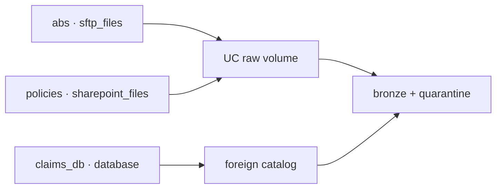

# Ingestion examples

Specs to copy when adding a source system. They are not deployed. The bundle that runs is [framework_ingestion](../../framework_ingestion/README.md).



Kinds & methods (NOW vs not): [Lucid · Ingestion kinds](https://lucid.app/lucidchart/4713f75e-9ce7-407b-a31c-5444a17b9ec9/edit?page=zl5N7dpZT3ez#).

The first folder is the source system. A project is a child folder and must match `requested_by`. A spec with no project sits next to `source.yaml` and omits `requested_by`.

```
ingestion/sources/
  abs/                          sftp_files. Files stay in a raw volume.
    source.yaml
    abs_reference.yaml          no project
    fdh/abs_invoices.yaml       project fdh
  policies/                     sharepoint_files. Same raw-volume load, Excel files.
    source.yaml
    underwriting/policies_quotes.yaml
  claims_db/                    database. No raw layer. Snapshot and merge.
    source.yaml
    claims_db_codes.yaml        no project, snapshot
    actuarial/claims_db_claims.yaml
  billing/                      sftp_files. Read by the sample projects
    billing/billing_invoices.yaml
  erp/                          database. Read by the sample projects
    erp/erp_customers.yaml
    billing/erp_orders.yaml
  hr_docs/                      sharepoint_files. Read by the sample projects
    hr/hr_docs_headcount.yaml
```

`billing`, `erp`, and `hr_docs` are the bronze tables the sample projects in [framework_curation](../../framework_curation/README.md) read. `./run.sh projects:generate` checks project references against this folder, not `framework_ingestion`.

There is no `cloud_files` example: its methods (`autoloader`, `copy_into`, `ctas`) are not in the MVP, and validation rejects them.

`./run.sh generate` reads `framework_ingestion` only. To check these specs:

```bash
venv/bin/python -m lakeflow_framework.cli generate framework_examples/ingestion --check
```

`--check` changes nothing. It validates every spec and prints any error, then ends with `out of date: SOURCE_MAP.md` and exit code 1, because this folder keeps no generated map; that last line is expected. `./run.sh projects:generate` also validates these specs, since it reads them as the projects' bronze. Drop `--check` only if you want the generated pipelines and jobs written into this folder.
