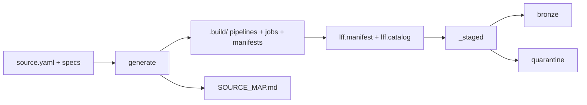
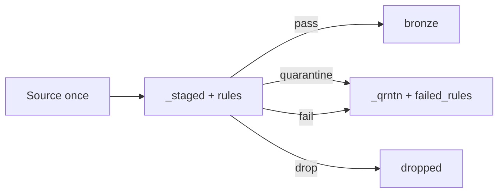
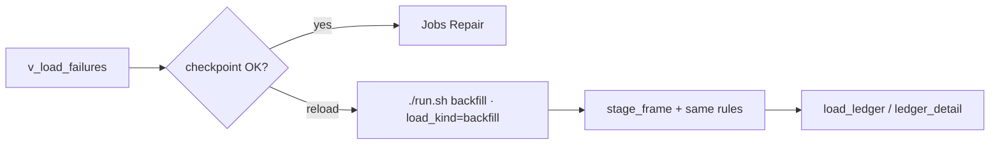

# Source ingestion bundle

Domain-owned ingestion into bronze. Projects do not own anything here. Any team can ask for a file or a table by adding a spec. Silver, gold, and data products belong to the project bundles in [framework_curation](../framework_curation/README.md).



Editable Lucid: [4. Ingestion kinds](https://lucid.app/lucidchart/4713f75e-9ce7-407b-a31c-5444a17b9ec9/edit?page=zl5N7dpZT3ez#) · [5. Quarantine](https://lucid.app/lucidchart/4713f75e-9ce7-407b-a31c-5444a17b9ec9/edit?page=zl5N9IbMke~5#) · [6. Backfill](https://lucid.app/lucidchart/4713f75e-9ce7-407b-a31c-5444a17b9ec9/edit?page=zl5NVfZfteiD#).

## Three bundles

| Bundle | Holds | Owner |
| --- | --- | --- |
| `framework_bundle` | The registry (`framework_meta`), the run and load views, hourly job-run recording, and `OPTIMIZE` | Platform team |
| `framework_ingestion` (this one) | Source to bronze | Domain, per source system |
| `framework_curation/<domain>/<project>` | Silver, gold, and data products | One project each |

Deploy order: `framework_bundle` (its deploy runs `framework_ddl`), then this bundle, then the projects.

## Source kinds

The kind is set once in the source system's `source.yaml`. Every table in that source inherits it.

| Kind | Data arrives as | Raw layer | Bronze load |
| --- | --- | --- | --- |
| `sftp_files` | Many files | A Unity Catalog volume (`raw_volume`) holding the files as delivered | Auto Loader reads the volume into bronze (`volume_files`) |
| `sharepoint_files` | Many files | The same raw volume | The same |
| `database` | Tables in PostgreSQL, Azure SQL, SQL Server, or DB2 | None. The source is a foreign catalog | Each table is read into bronze (`database_table`), `snapshot` or `merge` |
| `cloud_files` | Files on ADLS or S3 | A raw table | Auto Loader, COPY INTO, or CTAS into the raw table, then bronze. This is the original path. Not in the MVP: validation rejects these methods |

Rows that fail a quality rule go to a quarantine table beside bronze.

**Files:** the framework loads from the raw volume. It does not copy files from SFTP or SharePoint into the volume. Another process has to do that for now; see "Getting files into the raw volume" below.

**Databases:** the database is exposed through Lakehouse Federation as `foreign_catalog`. Every table in a delivery loads in the same run. `snapshot` mirrors the source table each run: with `primary_keys` a row the source dropped is kept, closed, and without keys bronze is replaced. `merge` keeps bronze in step with the source on `primary_keys` (`scd1`).

## Layout

```
framework_ingestion/
  databricks.yml
  sources/<source_system>/                 you edit these
    source.yaml                            kind, owner, raw volume or foreign catalog, deliveries
    <source_system>_<table>.yaml           a spec with no project
    <project>/
      <source_system>_<table>.yaml         a spec that project is bringing in
  profiles/                                optional shared defaults (`extends:`)
  src/                                     entry points the jobs call
  SOURCE_MAP.md                            generated and committed
  .build/                                  generated at validate/deploy (gitignored)
    manifests/<delivery>.json
    pipelines/<delivery>.py
    resources/<delivery>.pipeline.yml and .job.yml
  resources/                               hand-written only (e.g. registry_sync)
```

The first folder is the source system. The child folder is the project bringing the table in, and it matches `requested_by`. When there is no project, paste the spec next to `source.yaml` and omit `requested_by`. A table is registered once. A second project that needs the same table reads the existing bronze table and does not add a copy.

## What a spec holds

A spec holds only what is true of the table. The kind, raw volume, and foreign catalog come from the source's `source.yaml`. Prefer the terse form — omit domain, delivery, job_name, and requested_by when the folder and `source.yaml` already say them. Set `spec_version: 1` and point editors at the schema:

```yaml
# yaml-language-server: $schema=../../../.schemas/table-spec.v1.json
spec_version: 1
```

```yaml
# a file table                          # a database table
source:                                 source:
  raw_path: invoices/                     table: dbo.customers
  format: csv                             mode: merge
  delimiter: ","
```

**Precedence (highest wins):** table entry → `extends` profile → `source.yaml` / folder → framework default. Use `extends: profiles/...` and a `tables:` list to share format, classification, and notify across many tables in one file — see `profiles/README.md`.

The spec's `raw_to_bronze` section holds the bronze table, keys, columns, and quality rules. Its `quarantine` section holds the reject table. Specs do not name a catalog. Each job passes the environment's catalog.

## How a table loads: load type

`raw_to_bronze.load_type` says how bronze takes its rows. Leave it out and it is worked out from the older settings, so existing specs keep their meaning.

| `load_type` | What bronze holds | Needs | Notes |
| --- | --- | --- | --- |
| `insert_only` | Every row, appended. The default for files | Nothing | A file read twice is not read twice: Auto Loader remembers it |
| `scd1` | The latest row per key (an upsert) | `primary_keys` and `watermark_column`; `dedup: true` means the same | `delete_when` keeps a deleted row and flags it (below) |
| `scd2` | Every version of a row: `__START_AT`, `__END_AT`, and the current row has `__END_AT` empty | `primary_keys` and `watermark_column` | A new version opens only when the data changes, never because a load stamped it again |
| `full_refresh` | A database table, which follows `source.mode` | The foreign table | With `primary_keys`, a row the source dropped stays, closed (its last version has `__END_AT` set), instead of being deleted. Without keys the table is replaced each run |

```yaml
raw_to_bronze:
  load_type: scd1
  primary_keys: [invoice_id]
  watermark_column: updated_at
  delete_when: "status = 'DELETED'"      # that row is kept and flagged _is_deleted = true
```

`delete_when` is a SQL condition over the table's columns and only works with `scd1`. A file load with no `delete_when` never removes a row.

## Quality rules and quarantine



`raw_to_bronze.rules` holds SQL conditions every good row must meet. By default, a row that fails any rule goes to `<bronze table>_qrntn` with the names of the rules it failed in `failed_rules`; the other rows load, and the run still shows `COMPLETED` with `rows_quarantined` set. A rule must be true for a good row and a NULL result fails it, so a column that may be empty says `col IS NULL OR ...`.

A quarantine table is created only when the spec asks for one:

| Spec has | Quarantine table | A row failing the framework's own checks (`cast_<column>`, `not_null_<key>`, `schema_conformance`) |
| --- | --- | --- |
| `rules:` (with or without `on_fail`) | `<bronze table>_qrntn` beside bronze, or as the `quarantine:` block says | Follows `raw_to_bronze.on_fail` (default `quarantine`) |
| Only a `quarantine:` block | As the block says | Quarantined |
| None of these | None, and no quarantine flow | Dropped, counted in `rows_dropped` |

All three are optional: a table that needs no quarantine leaves out `rules`, `on_fail`, and the `quarantine:` block. `on_fail` sets what happens to a row that fails a rule, so it needs `rules`: `./run.sh generate` refuses a spec with `raw_to_bronze.on_fail` and no rules.

The quarantine table has bronze's columns and types plus `failed_rules`. A value that cannot be converted to its bronze type (the sequence column of a dedup load) is NULL in the column and kept as text in `_rescued_data`, under the column's name.

```yaml
raw_to_bronze:
  rules:
    - { name: ride_id_present, expression: "ride_id IS NOT NULL AND length(trim(ride_id)) > 0" }
    - { name: ride_id_format,  expression: "ride_id rlike '^[0-9A-Fa-f]{16}$'" }      # regex, anchored
    - { name: bike_type_known, expression: "rideable_type IN ('classic_bike', 'electric_bike')" }
    - { name: ended_after_start, expression: "try_cast(ended_at AS timestamp) >= try_cast(started_at AS timestamp)" }
```

What happens to a failing row is a choice: `on_fail` is `quarantine` (the default), `drop`, `warn` or `fail`, set in one place only, either on `raw_to_bronze` for every rule or on each rule, never both. `fail` blocks the whole **file** that holds a bad row: none of its rows reach bronze, its bad rows go to quarantine, the run and job end `FAILED` naming the file, and the file is not picked up again. `framework_backfill` reloads files by name or arrival date, or refreshes a table, through the same rules. A table in a scheduled delivery also expects a file with rows each run: none, or an empty one, is recorded `FAILED` in the ledger while the job still succeeds (`source.expect_file`; see QUALITY_RULES.md). `abs_gl.yaml` shows every option of a spec, commented, at the bottom.

`rlike` matches anywhere in the value, so anchor a pattern with `^` and `$`, and write `[0-9]` instead of `\d`: a single backslash is dropped silently. `./run.sh generate` reads a rule as text. It catches an unknown column, an unapproved function, an unclosed bracket or a half-written condition, but not a regex that does not compile or a function with the wrong arguments, which would fail the whole update at load time. Run **`./run.sh check:rules <profile> <warehouse-id> [catalog]`** before a deploy that changes a rule: it evaluates every rule on a warehouse, and with a catalog also counts the rows each would quarantine. **[QUALITY_RULES.md](QUALITY_RULES.md)** has the regex guide, a copyable pattern list, every kind of check you can add (presence, length, allowed values, numbers, dates, across columns, conditional), the approved functions, the checks that are on by default, what a rule cannot do, how to test a rule against existing data before deploying, and where the results show up. `abs_gl.yaml` has a full example with two rules per column.

## Audit columns

Every bronze and quarantine table carries the same audit columns. They need no setting and are not part of the data, so they are left out of the row hash and never open an SCD2 version.

| Column | Holds |
| --- | --- |
| `_src_file_path`, `_src_file_name` | The file the row came from (file sources) |
| `_src_row_hash` | SHA-256 of everything the source gave the row, including `_rescued_data`. An empty string and a null differ. Compare two loads of a row to see if its content changed |
| `_batch_id` | One id for the whole pipeline run. `load_ledger.batch_id` holds the same value beside the real update id, so a row joins to its load |
| `_ingest_timestamp` | When the pipeline wrote the row |
| `_rescued_data` | Values that did not fit the declared columns (CSV, delimited, JSON, text) |
| `_is_deleted` | Only with `delete_when` |

Both tables also keep a Delta change feed for 30 days and are clustered on `_ingest_timestamp`, so a reader that wants only newer rows skips the older files. A pipeline cannot read its own update id, which is why `_batch_id` is its own id rather than the update id.

## Curated readers: only what is new

```python
from lakeflow_framework.silver_reader import read_new

changes = read_new(
    spark,
    source_table="cat.billing_bronze.invoices",
    reader_table="cat.silver.invoices_clean",
    keys=["invoice_id"],
)
changes.frame  # the new rows, plus _change_type
# ... merge changes.frame into the reader table ...
changes.commit()  # only now: record how far the reader has consumed
```

`mode="auto"` (the default) uses the change feed when the source has it, and otherwise the load time. Argument order is **source then reader** (any upstream → any curated consumer).

| | Change feed | Load time (no feed) |
| --- | --- | --- |
| Finds | Exactly the commits the reader has not consumed | Rows with `_ingest_timestamp` after the last read |
| `_change_type` | `insert`, `update`, `delete` | `upsert` (new or changed), `delete` for a row flagged `_is_deleted` |
| Sees a removed row | Yes | No, only a flagged one |
| Sees an SCD2 closure | Yes | No, so SCD2 sources must use the feed |
| First read | The whole table, as `insert` | The whole table |

Progress is one row per `(reader_table, source_table)` in `framework_meta.flow_checkpoint` (layer-independent). The read is pinned to one table version, so rows committed meanwhile are picked up next time and none are skipped. `commit()` comes after the reader has used the rows, so a run that stops before it reads the same rows again: **the merge must be idempotent.** With `keys`, the feed leaves out an update that only restamped a row without changing its content.

If the source is rebuilt (a full refresh, a replace, a restore), the change feed cannot be followed across it. The reader stops and says so. Delete every row for that `(reader_table, source_table)` pair in `flow_checkpoint` (it is append-only and `v_flow_checkpoint` falls back to the newest remaining `SUCCEEDED` row, so deleting only the latest one resumes from an older mark), rebuild the reader table, and the next read starts again from the source as it is.

## Describe your tables and columns

`description:` on a spec describes the bronze table and `quarantine.description` the reject table. A `description:` on each declared column describes that column. They are stored in `framework_meta.v_tables.description` and `v_columns.description`. The table description is the table comment in Unity Catalog, and `registry_sync` sets each column's description as its column comment at every deploy (tags stay parked). A comment lives on the table, so after a full refresh run `databricks bundle run registry_sync` to put the comments back. The audit columns have standard descriptions. Descriptions of columns are only kept for columns the spec declares under `columns:`; a table that declares none lets Auto Loader infer its types (`source.infer_schema: strings` keeps every column a string), and only its audit columns are registered at deploy. After its first load, the job's `infer_columns` task registers bronze's own columns (no descriptions) and `registry_sync` keeps them; declaring `columns` later replaces them.

`./run.sh generate` prints a warning for every table with no description, every declared column with none, and every table that declares no columns. It never stops a deploy. `./run.sh new-table` writes `TODO` placeholders, and `generate` refuses a file until they are replaced.

## How a load is recorded

The pipeline records its own load, once per update, in `framework_meta.load_ledger` (read it through `v_loads` / `v_ledger_detail` / `v_load_failures` — see [root README · views by usage](../README.md#query-views-by-usage)). There is one row per table per run:



| Column | Meaning |
| --- | --- |
| `rows_read` | Rows taken from the source files or table |
| `rows_inserted`, `rows_updated`, `rows_deleted` | What happened in the target table |
| `rows_quarantined`, `rows_dropped` | Rows that failed a rule (quarantine vs drop/block) |
| `source_kind`, `run_as`, `load_kind` | Source type, identity, and regular / backfill / catchup |
| `target_status` | `COMPLETED`, `FAILED`, or `CANCELED` (quarantine issues fold into `failure_reason`) |
| `failure_reason` | The error the run reported, or why the table could not register |
| `batch_id`, `update_id` | The `_batch_id` on the rows, and the Databricks update |

Counts are always numbers. A run with no new files records zeros. In a failed run, the counts of a step that did not finish are zero, and the error text is kept. A table whose spec cannot register is recorded `FAILED` with that error, and the other tables in the delivery still load. Child file/input rows land in `ledger_detail` (`v_ledger_detail`).

The job has one task, the pipeline refresh. Job runs themselves are recorded hourly by `framework_runs` (it also catches runs that never reached the pipeline). The pipeline cannot see which job run started it, so `job_run_id` is empty in the ledger; `v_load_failures` joins to the run by time.

```sql
SELECT dataflow, target_table, load_kind, rows_read, rows_inserted, rows_quarantined, target_status, failure_reason
FROM <catalog>.framework_meta.v_loads WHERE job_name = 'abs_daily' ORDER BY started_at DESC;
```

## One delivery, one pipeline, one job

A delivery is how a source's data arrives: a schedule, or for file kinds a file-arrival trigger on the raw volume. Every table in a delivery, whichever team asked for it, loads in the same Lakeflow pipeline and the same job. The job refreshes the pipeline; the pipeline reads one compiled `lff.manifest` JSON for the delivery (legacy `lff.specs` still works). Deploy writes the source, its schemas, and the specs into the registry and applies their Unity Catalog tags and column comments; a run does neither. The pipeline publishes its event log as `framework_events.<job>_event_log`, and records its own counts, status, and errors in `load_ledger` / `v_loads` once per update (an event hook; the job has no recording task). The flows are drawn in [ARCHITECTURE.md](../framework_docs/ARCHITECTURE.md#flows). Different cadences from one source are separate deliveries.

A delivery on a file-arrival trigger watches one volume, so its tables must read the same volume. A delivery on a schedule has no such limit: its tables may read different volumes. Several tables can share one spec file with a `tables:` list (shared settings at the top, each entry overrides them), so give each entry its own `bronze.table` or they will collide on one target. Tables in one delivery load together, and one table that fails to register is skipped and recorded while the others still load.

## Add a table to a source system

1. New source system only: `./run.sh new-source <domain> <source_system> <owner-email> [kind] [delivery]`. It creates `source.yaml` for that kind.
2. `./run.sh new-table <domain> <source_system> <table> <requested-by> [delivery]`. It creates the spec from a template for that kind. The `delivery` argument is only needed when the source has several.
3. Edit the new file and replace every `TODO`. `generate` refuses files that still have one.
4. Run `./run.sh generate`.

That is all. The generator validates every source and spec, then rewrites the map, the pipeline files, and the jobs. Do not edit generated files. Their first line says so, and the next `generate` overwrites them. It deletes generated files that no source asks for any more, and never touches a file without that first line.

## The map

`SOURCE_MAP.md` shows who requested what, each source's raw volume or foreign catalog, its deliveries, every table with where it reads and its bronze target, and a diagram. It comes from the same model as the jobs, so it describes what is deployed.

`./run.sh bundle:validate` and `bundle:deploy` run `generate` first, so the map and the resources are rewritten before the bundle is checked. They do not look at `framework_curation`, which is a separate bundle with its own `./run.sh projects:generate`. An invalid spec stops the run before Databricks is contacted. `./run.sh generate:check` changes nothing and fails if the generated files are out of date, for CI.

## Deploy

```bash
./run.sh bundle:validate framework_ingestion dev <profile>
./run.sh bundle:deploy framework_ingestion dev <profile>
```

Run it in the project's virtual environment (`source venv/bin/activate`): the bundle builds the wheel with `python -m pip wheel`, so `python` must be on the path. Every change to the library needs a new `PACKAGE_VERSION` (and the same in `pyproject.toml`), or serverless can reuse the wheel it cached. `.build/` is gitignored, and a bundle upload skips ignored files, so `databricks.yml` lists `.build/pipelines/*.py` and `.build/manifests/*.json` under `sync.include`. Without that the pipeline file never reaches the workspace.

Deploy uploads the bundle, then runs `registry_sync`; the deploy fails if it fails. That job writes every source system, schema, job, and spec into `framework_meta` under the target catalog as SCD Type 2 versions, retires anything removed from the bundle, then sets the schema, table, and column tags and the column comments in Unity Catalog. A schema or table whose pipeline has not run yet is tagged on the next deploy. This bundle must be the only one that registers source systems in its catalog, because a deploy retires every source system object it does not define. The framework bundle must already be deployed, because that deploy creates the registry.

## Prerequisites

The framework does not create these. The domain makes sure they exist before a deploy:

- The catalog, and permission to create tables and views in it.
- For every source system: the schemas its specs name (raw, bronze, quarantine). Schemas default to `<source_system>_<layer>`.
- For file kinds: the raw volume named in `raw_volume`. The file-arrival trigger needs it when the job is created.
- For `database`: the foreign catalog, with read access to the source tables.
- Something that delivers the files into the raw volume (see below).

## Ownership and the registry

Bronze is owned by the **source system**. The registry stores `owner_kind = source_system` and `owner = <source system>` on every row, with `requested_by` (the team that asked for the table) and `delivery` beside it. A table has one owner, and `registry_sync` refuses a second owner's registration and records a failed `ownership_check` step. The team that asked for a table never owns it.

Deploy registers each delivery's workflow, one pipeline and dataflow per table, the layer flows, securables, links, and columns. Query run status with `v_job_status`, definitions with `v_workflows` / `v_pipelines` / `v_dataflows` / `v_flows`, and filter by `owner`. The full view list is in the [root README](../README.md#see-what-is-running).

`requested_by` is the project folder. Omit it only when the spec sits next to `source.yaml`. A spec that says `project:` instead of `requested_by:` is rejected.

## Getting files into the raw volume

This bundle reads from the raw volume. It does not copy files from SFTP or SharePoint into it, so something else must, such as Lakeflow Connect, ADF, or a copy job. A `fetch` setting in `source.yaml` is rejected until that step exists. Building the Lakeflow Connect ingestions is the first item of [phase 1](../framework_docs/ROADMAP.md).

## Known gaps

- Run on a real workspace: file loads from a volume with Auto Loader on a schedule, the manifest and pipeline upload, the per-update ledger (a load, and a run with no new files), the audit columns, the change feed on `insert_only` bronze, the silver reader in both modes, and registry descriptions.
- Not yet run on a workspace: the file-arrival trigger, a database source (no foreign catalog yet, so database soft deletes are tested only with unit tests and a stand-in table), `scd1`, `scd2` and `delete_when` on files, and the ledger row for a run that fails.
- Rebuilding a bronze table (a full refresh) resets its change feed, so every silver table that reads it must rebuild too (see "Silver reads only what is new").
- `fixed_width` and `yaml` files are not supported from a raw volume yet.
- A delivery's tables share one pipeline, so one bad spec can fail the others. Splitting a busy delivery is not built.
- The sample specs are for illustration. `framework_examples/consumer` registers `billing_invoices` too, so do not deploy both to the same catalog.
