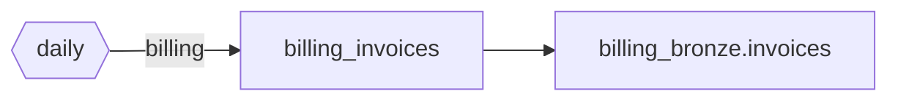
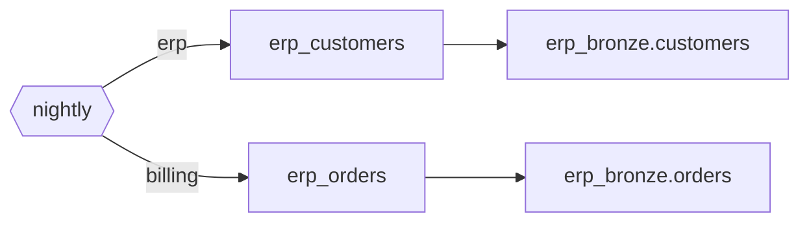
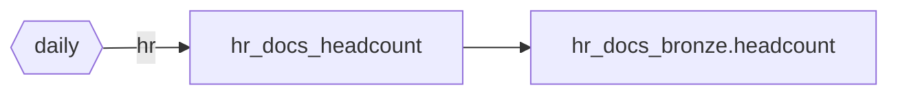

# Source ingestion map

Generated by `lakeflow-framework generate`. Do not edit; change `source.yaml` or a table
spec and regenerate. `./run.sh bundle:validate` regenerates it first.

## Requested by

| Team or project | Tables | Source systems |
| --- | --- | --- |
| billing | 2 | billing, erp |
| erp | 1 | erp |
| hr | 1 | hr_docs |

## finance / billing

Kind: sftp_files. Owner: billing.owner@jll.com.
Raw volume: `billing_raw.landing`. Files land here as delivered, and bronze reads them from it.

| Delivery | When |
| --- | --- |
| daily | file_arrival |

| Table | Delivery | Requested by | Reads | Load | Bronze | Technical owner |
| --- | --- | --- | --- | --- | --- | --- |
| billing_invoices | daily | billing | volume billing_raw.landing/invoices (csv) | volume_files | billing_bronze.invoices | billing.owner@jll.com |

## finance / erp

Kind: database. Owner: erp.owner@jll.com.
Foreign catalog: `erp_federated` (sql_server). Tables load straight to bronze.

| Delivery | When |
| --- | --- |
| nightly | cron `0 0 2 * * ?` |

| Table | Delivery | Requested by | Reads | Load | Bronze | Technical owner |
| --- | --- | --- | --- | --- | --- | --- |
| erp_customers | nightly | erp | dbo.customers (merge) | database_table | erp_bronze.customers | erp.owner@jll.com |
| erp_orders | nightly | billing | dbo.orders (snapshot) | database_table | erp_bronze.orders | erp.owner@jll.com |

## people / hr_docs

Kind: sharepoint_files. Owner: hr.owner@jll.com.
Raw volume: `hr_docs_raw.landing`. Files land here as delivered, and bronze reads them from it.

| Delivery | When |
| --- | --- |
| daily | file_arrival |

| Table | Delivery | Requested by | Reads | Load | Bronze | Technical owner |
| --- | --- | --- | --- | --- | --- | --- |
| hr_docs_headcount | daily | hr | volume hr_docs_raw.landing/headcount (excel) | volume_files | hr_docs_bronze.headcount | hr.owner@jll.com |

