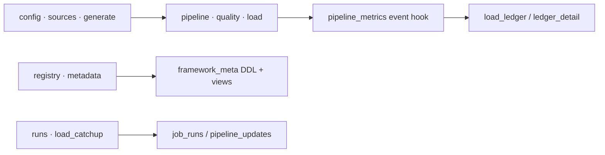

# lakeflow_framework

Config-driven ingestion for Databricks Lakeflow on Python 3.11 or 3.12. Pin this wheel and supply YAML: a `source.yaml` per source system and a spec per table. The package validates them, generates the pipelines, jobs, and maps, and builds each pipeline's datasets.



Data model and view usage: [root README](../README.md#framework_meta-data-model) · [Lucid ERD](https://lucid.app/lucidchart/4713f75e-9ce7-407b-a31c-5444a17b9ec9/edit).

```python
from lakeflow_framework import build_pipelines

build_pipelines(["billing_invoices", "billing_credits"])
```

Generated pipeline files contain one `build_pipelines` call per delivery, so the registry is read once. `build_pipeline("billing_invoices")` remains the single-table call. Nobody writes these by hand.

```bash
lakeflow-framework generate framework_ingestion          # specs to pipelines, jobs, SOURCE_MAP.md
lakeflow-framework projects generate framework_curation --sources framework_ingestion
lakeflow-framework validate <folder> --catalog <catalog>  # check specs; no cluster
```

`./run.sh` in the repository root wraps these. `databricks bundle deploy` builds this package; jobs and pipelines reference `dist/*.whl`. The repository overview is the root `README.md`, and every YAML contract is in `framework_docs/README.md`.
