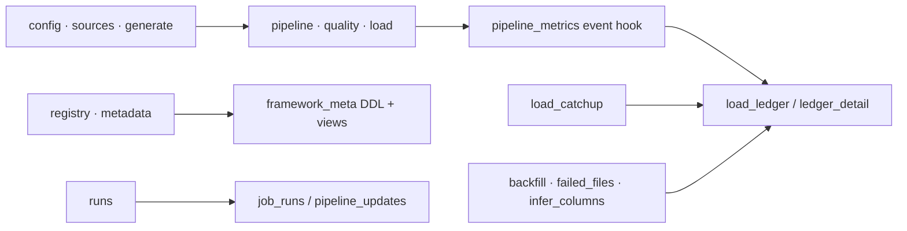

# lakeflow_framework

Config-driven ingestion for Databricks Lakeflow on Python 3.11 or 3.12. Pin this wheel and supply YAML: a `source.yaml` per source system and a spec per table. The package validates them, generates the pipelines, jobs, and maps, and builds each pipeline's datasets.



Other modules: `backfill` (the `framework_backfill` job), `failed_files` (moves blocked files to `_failed`), `infer_columns` (registers the columns of a table that declares none), `rule_check` and `expand` (behind the CLI), and `silver_reader` (`read_new`, for curated readers).

Data model and view usage: [root README](../README.md#framework_meta-data-model) · [Lucid ERD](https://lucid.app/lucidchart/4713f75e-9ce7-407b-a31c-5444a17b9ec9/edit).

```python
from lakeflow_framework import build_pipelines

build_pipelines(["billing_invoices", "billing_credits"])
```

Generated pipeline files contain one `build_pipelines` call per delivery, so the registry is read once. `build_pipeline("billing_invoices")` remains the single-table call. Nobody writes these by hand. The package also exports `validate_configs`, `PipelineConfig`, `ConfigValidationError`, `MetadataNotFound`, and `LoadMethod` (the load method names).

```bash
lakeflow-framework generate framework_ingestion [--check]  # specs to pipelines, jobs, SOURCE_MAP.md
lakeflow-framework validate <files-or-folders> [--catalog <catalog>]  # check specs; no cluster
lakeflow-framework new-source <bundle> <domain> <source_system> --owner <email> [--kind] [--delivery]
lakeflow-framework new-table <bundle> <domain> <source_system> <table> [--requested-by] [--delivery]
lakeflow-framework expand <spec.yaml> --catalog <catalog> [--out <folder>]  # the pipeline as .py and .sql
lakeflow-framework check-rules <bundle> --warehouse <id> [--profile] [--catalog]  # rules on a warehouse
lakeflow-framework projects generate framework_curation --sources <ingestion folder> [--check]
lakeflow-framework projects new framework_curation --domain <d> --project <p> --owner <email>
lakeflow-framework apply-metadata <spec files> --catalog <catalog>  # column comments; needs Spark
lakeflow-framework batch-sql <spec files> --pipeline <id>  # COPY INTO / CTAS SQL (frozen methods)
```

`./run.sh` in the repository root wraps these. `databricks bundle deploy` builds this package; jobs reference `dist/*.whl`, and pipelines the wheel the deploy uploads. The repository overview is the root `README.md`, and every YAML contract is in `framework_docs/README.md`.
