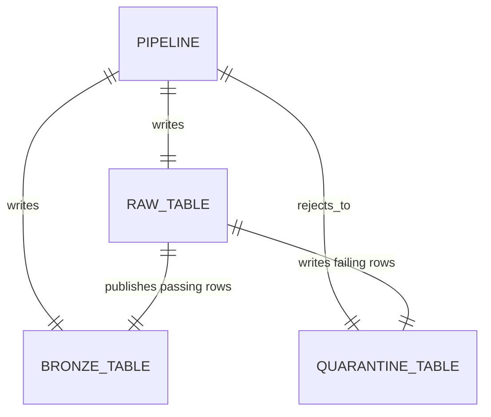

# lakeflow_framework

Standalone Lakeflow file ingestion for Python 3.11. Allianz teams pin this wheel and supply one bronze YAML file per pipeline. The load is source to raw, then raw to bronze, with failures in quarantine.



```python
from lakeflow_framework import build_pipeline

build_pipeline("billing_invoices")
```

Validate before a cluster starts:

```bash
lakeflow-framework validate configs/bronze
```

`databricks bundle deploy` builds this package. Jobs and pipelines reference `dist/*.whl`. The repository overview is the root `README.md`. The entity model is `framework_docs/ARCHITECTURE.md`. The YAML contract is `framework_docs/README.md`. Sample bronze configs and tests are in `framework_examples/consumer`.
